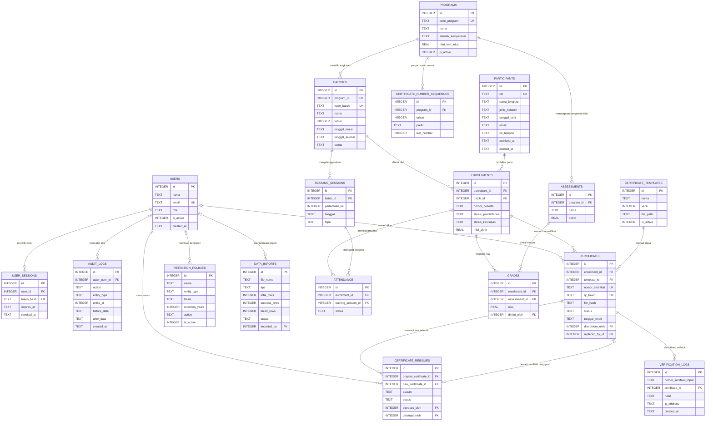

# ERD Sistem e-ARSIP

| Metadata | Keterangan |
| --- | --- |
| Versi dokumen | 1.0 (draft untuk review) |
| Tanggal | 2026-10-19 |
| Database | SQLite 3.35+ |
| Tiket terkait | ARSIP-002 (perancangan skema database) |
| Requirement | FR-01 s/d FR-06 |
| Lampiran | [`erd.dbml`](./erd.dbml) untuk dbdiagram.io |

## 1. Tujuan & Cakupan

Dokumen ini merancang skema database untuk Sistem e-ARSIP sertifikat pelatihan: master data program/angkatan/peserta, pencatatan kelas dan nilai, penerbitan sertifikat bernomor unik, verifikasi publik, retensi data, serta jejak audit penerbitan ulang.

Cakupan tabel:

- **Auth & audit**: `users`, `user_sessions`, `audit_logs`
- **Master data**: `programs`, `batches`, `participants`
- **Transaksional**: `enrollments`, `training_sessions`, `attendance`, `assessments`, `grades`
- **Sertifikasi**: `certificate_templates`, `certificates`, `certificate_reissues`, `certificate_number_sequences`
- **Pendukung**: `verification_logs`, `retention_policies`, `data_imports`

## 2. Prinsip Desain

1. **Storage class SQLite**: `INTEGER`, `TEXT`, `REAL`, `BLOB`. Tidak ada tipe `BOOLEAN`, `DATE`, atau `ENUM` native.
2. **Boolean** disimpan sebagai `INTEGER` 0/1 dengan `CHECK (kolom IN (0,1))`.
3. **Tanggal/waktu** disimpan sebagai `TEXT` ISO-8601 UTC (`YYYY-MM-DDTHH:MM:SSZ`); tanggal saja `YYYY-MM-DD`. Perbandingan leksikografis tetap valid karena formatnya seragam.
4. **Enum** direpresentasikan dengan `CHECK (kolom IN (...))` agar tidak perlu tabel lookup untuk nilai yang stabil.
5. **JSON** disimpan sebagai `TEXT` dan divalidasi `json_valid()` (fitur JSON1).
6. **Soft delete** memakai `deleted_at`; data retensi memakai `archived_at` + `storage_tier`.
7. **Partial unique index** dipakai agar constraint hanya berlaku pada baris aktif.
8. **Foreign key** wajib diaktifkan per koneksi: `PRAGMA foreign_keys = ON`.
9. **Naming**: tabel `snake_case` plural, kolom `snake_case`, index berprefix `ux_` (unique) / `ix_` (non-unique).
10. **Single writer**: SQLite hanya mengizinkan satu penulis; operasi kritis (generate nomor sertifikat, reissue) wajib memakai transaksi `BEGIN IMMEDIATE`.

## 3. Diagram ERD



Catatan: relasi `certificates.replaced_by_id` (self-reference) tidak digambar agar diagram tidak penuh; detailnya ada di kamus data.

## 4. Kamus Data

### 4.1 `users`

Akun staf yang dapat login. Role dibatasi dua nilai sesuai kebutuhan Sprint 1.

| Kolom | Tipe | Constraint | Deskripsi |
| --- | --- | --- | --- |
| id | INTEGER | PK | ID internal |
| nama | TEXT | NOT NULL | Nama lengkap staf |
| email | TEXT | NOT NULL | Login identifier; unik case-insensitive pada user aktif |
| password_hash | TEXT | NOT NULL | Hash Argon2id/bcrypt; tidak pernah menyimpan password mentah |
| role | TEXT | NOT NULL, CHECK in (`admin`, `staf_arsip`) | Otorisasi RBAC |
| is_active | INTEGER | NOT NULL DEFAULT 1, CHECK in (0,1) | Status akun |
| last_login_at | TEXT | NULL | Waktu login terakhir |
| created_at | TEXT | NOT NULL | Timestamp dibuat |
| updated_at | TEXT | NOT NULL | Timestamp diubah |
| deleted_at | TEXT | NULL | Soft delete |

Index: `ux_users_email` pada `lower(email)` `WHERE deleted_at IS NULL`.

> **Catatan implementasi Laravel:** tabel `user_sessions` pada rancangan awal digantikan tabel `sessions`
> bawaan Laravel (driver `database`) karena aplikasi memakai autentikasi session + cookie, bukan token API.
> Tabel `users` juga mendapat kolom `remember_token`, `email_verified_at`, dan `deleted_at` dari fitur
> autentikasi dan soft delete Laravel.

### 4.2 `user_sessions`

Sesi login berbasis token. Token asli hanya dikirim ke klien; database menyimpan hash.

| Kolom | Tipe | Constraint | Deskripsi |
| --- | --- | --- | --- |
| id | INTEGER | PK | ID internal |
| user_id | INTEGER | NOT NULL, FK → users.id, ON DELETE CASCADE | Pemilik sesi |
| token_hash | TEXT | NOT NULL UNIQUE | SHA-256 token sesi |
| expires_at | TEXT | NOT NULL | Masa berlaku |
| revoked_at | TEXT | NULL | Waktu logout/revoke |
| ip_address | TEXT | NULL | IP saat login |
| user_agent | TEXT | NULL | Browser/klien |
| created_at | TEXT | NOT NULL | Timestamp dibuat |

Index: `ix_user_sessions_user_expiry (user_id, expires_at)`.

### 4.3 `programs`

Master program pelatihan.

| Kolom | Tipe | Constraint | Deskripsi |
| --- | --- | --- | --- |
| id | INTEGER | PK | ID internal |
| kode_program | TEXT | NOT NULL UNIQUE | Kode baku program, dipakai pada nomor sertifikat |
| nama | TEXT | NOT NULL | Nama program |
| deskripsi | TEXT | NULL | Deskripsi |
| standar_kompetensi | TEXT | NULL | Acuan standar kompetensi (FR-02) |
| durasi_jam | INTEGER | CHECK ≥ 0 | Total jam pelatihan |
| nilai_min_lulus | REAL | NOT NULL DEFAULT 70, CHECK 0–100 | Batas kelulusan |
| is_active | INTEGER | NOT NULL DEFAULT 1, CHECK in (0,1) | Status program |
| created_at | TEXT | NOT NULL | Timestamp dibuat |
| updated_at | TEXT | NOT NULL | Timestamp diubah |
| deleted_at | TEXT | NULL | Soft delete |

### 4.4 `batches`

Angkatan/batch/kelas dari suatu program.

| Kolom | Tipe | Constraint | Deskripsi |
| --- | --- | --- | --- |
| id | INTEGER | PK | ID internal |
| program_id | INTEGER | NOT NULL, FK → programs.id, ON DELETE RESTRICT | Program induk |
| kode_batch | TEXT | NOT NULL UNIQUE | Kode kelas, mis. `2021-01` |
| nama | TEXT | NOT NULL | Nama angkatan/kelas |
| tahun | INTEGER | NOT NULL, CHECK 1900–2200 | Tahun pelatihan (filter pencarian) |
| tanggal_mulai | TEXT | NULL | Tanggal mulai |
| tanggal_selesai | TEXT | NULL, CHECK ≥ tanggal_mulai | Tanggal selesai; basis retensi |
| kuota | INTEGER | CHECK ≥ 0 | Kapasitas |
| lokasi | TEXT | NULL | Tempat pelaksanaan |
| status | TEXT | NOT NULL DEFAULT `direncanakan`, CHECK in (`direncanakan`, `berjalan`, `selesai`, `dibatalkan`) | Status angkatan |
| created_at | TEXT | NOT NULL | Timestamp dibuat |
| updated_at | TEXT | NOT NULL | Timestamp diubah |
| deleted_at | TEXT | NULL | Soft delete |

Index: `ix_batches_program_tahun (program_id, tahun)`, `ix_batches_tahun_status (tahun, status)`.

### 4.5 `participants`

Master biodata peserta. NIK wajib 16 digit.

| Kolom | Tipe | Constraint | Deskripsi |
| --- | --- | --- | --- |
| id | INTEGER | PK | ID internal |
| nik | TEXT | NOT NULL UNIQUE, CHECK 16 digit angka | Nomor Induk Kependudukan |
| nama_lengkap | TEXT | NOT NULL | Nama sesuai identitas |
| jenis_kelamin | TEXT | CHECK in (`L`, `P`) | Jenis kelamin |
| tempat_lahir | TEXT | NULL | Tempat lahir |
| tanggal_lahir | TEXT | NULL | Tanggal lahir `YYYY-MM-DD` |
| alamat | TEXT | NULL | Alamat (tidak boleh tampil publik) |
| email | TEXT | NULL | Email; unik case-insensitive bila diisi |
| no_telepon | TEXT | NULL | Nomor telepon |
| pendidikan_terakhir | TEXT | NULL | Pendidikan terakhir |
| pekerjaan | TEXT | NULL | Pekerjaan |
| instansi | TEXT | NULL | Instansi/perusahaan |
| foto_path | TEXT | NULL | Path foto peserta |
| catatan | TEXT | NULL | Catatan internal |
| archived_at | TEXT | NULL | Waktu diarsipkan (retensi) |
| storage_tier | TEXT | NOT NULL DEFAULT `hot`, CHECK in (`hot`, `cold`) | Lokasi penyimpanan berkas |
| created_at | TEXT | NOT NULL | Timestamp dibuat |
| updated_at | TEXT | NOT NULL | Timestamp diubah |
| deleted_at | TEXT | NULL | Soft delete |

Index: `ux_participants_nik`, `ix_participants_nama (nama_lengkap COLLATE NOCASE)`, `ux_participants_email` pada `lower(email)` `WHERE email IS NOT NULL AND deleted_at IS NULL`, `ix_participants_deleted (deleted_at)`.

### 4.6 `enrollments`

Relasi peserta ↔ angkatan, sekaligus menyimpan status pendaftaran, kelulusan, dan nilai akhir.

| Kolom | Tipe | Constraint | Deskripsi |
| --- | --- | --- | --- |
| id | INTEGER | PK | ID internal |
| participant_id | INTEGER | NOT NULL, FK → participants.id, ON DELETE RESTRICT | Peserta |
| batch_id | INTEGER | NOT NULL, FK → batches.id, ON DELETE RESTRICT | Angkatan |
| nomor_peserta | TEXT | NULL | Nomor urut peserta dalam angkatan |
| status_pendaftaran | TEXT | NOT NULL DEFAULT `terdaftar`, CHECK in (`terdaftar`, `aktif`, `mengundurkan_diri`, `selesai`, `dibatalkan`) | Status proses |
| status_kelulusan | TEXT | NOT NULL DEFAULT `belum_dinilai`, CHECK in (`belum_dinilai`, `lulus`, `tidak_lulus`) | Hasil akhir |
| tanggal_daftar | TEXT | NOT NULL | Tanggal pendaftaran |
| nilai_akhir | REAL | NULL, CHECK 0–100 | Nilai akhir terbobot (dihitung aplikasi) |
| created_at | TEXT | NOT NULL | Timestamp dibuat |
| updated_at | TEXT | NOT NULL | Timestamp diubah |
| deleted_at | TEXT | NULL | Soft delete |

Index: `ux_enrollments_participant_batch (participant_id, batch_id)` partial `WHERE deleted_at IS NULL`; `ux_enrollments_batch_nomor (batch_id, nomor_peserta)` partial `WHERE nomor_peserta IS NOT NULL AND deleted_at IS NULL`; `ix_enrollments_batch_status (batch_id, status_kelulusan)`.

### 4.7 `training_sessions`

Pertemuan/sesi kelas dalam satu angkatan.

| Kolom | Tipe | Constraint | Deskripsi |
| --- | --- | --- | --- |
| id | INTEGER | PK | ID internal |
| batch_id | INTEGER | NOT NULL, FK → batches.id, ON DELETE CASCADE | Angkatan |
| pertemuan_ke | INTEGER | NOT NULL, CHECK > 0 | Urutan pertemuan |
| tanggal | TEXT | NOT NULL | Tanggal sesi |
| topik | TEXT | NULL | Materi/topik |
| pengajar | TEXT | NULL | Nama pengajar (bisa dinormalisasi nanti) |
| catatan | TEXT | NULL | Catatan sesi |
| created_at | TEXT | NOT NULL | Timestamp dibuat |
| updated_at | TEXT | NOT NULL | Timestamp diubah |

Unique: `ux_training_sessions_batch_pertemuan (batch_id, pertemuan_ke)`.

### 4.8 `attendance`

Presensi per peserta per sesi.

| Kolom | Tipe | Constraint | Deskripsi |
| --- | --- | --- | --- |
| id | INTEGER | PK | ID internal |
| enrollment_id | INTEGER | NOT NULL, FK → enrollments.id, ON DELETE CASCADE | Peserta dalam angkatan |
| training_session_id | INTEGER | NOT NULL, FK → training_sessions.id, ON DELETE CASCADE | Sesi |
| status | TEXT | NOT NULL, CHECK in (`hadir`, `izin`, `sakit`, `alpa`) | Status kehadiran |
| catatan | TEXT | NULL | Keterangan |
| dicatat_oleh | INTEGER | NULL, FK → users.id, ON DELETE SET NULL | Staf pencatat |
| created_at | TEXT | NOT NULL | Timestamp dibuat |
| updated_at | TEXT | NOT NULL | Timestamp diubah |

Unique: `ux_attendance_enrollment_session (enrollment_id, training_session_id)`.

### 4.9 `assessments`

Komponen penilaian per program (mis. Teori 40%, Praktik 60%).

| Kolom | Tipe | Constraint | Deskripsi |
| --- | --- | --- | --- |
| id | INTEGER | PK | ID internal |
| program_id | INTEGER | NOT NULL, FK → programs.id, ON DELETE CASCADE | Program |
| nama | TEXT | NOT NULL | Nama komponen |
| bobot | REAL | NOT NULL, CHECK 0–100 | Bobot persen |
| urutan | INTEGER | NOT NULL DEFAULT 0 | Urutan tampil |
| created_at | TEXT | NOT NULL | Timestamp dibuat |
| updated_at | TEXT | NOT NULL | Timestamp diubah |

Unique: `ux_assessments_program_nama (program_id, nama)`. Total `bobot` per program = 100 divalidasi di aplikasi.

### 4.10 `grades`

Nilai peserta per komponen penilaian.

| Kolom | Tipe | Constraint | Deskripsi |
| --- | --- | --- | --- |
| id | INTEGER | PK | ID internal |
| enrollment_id | INTEGER | NOT NULL, FK → enrollments.id, ON DELETE CASCADE | Peserta dalam angkatan |
| assessment_id | INTEGER | NOT NULL, FK → assessments.id, ON DELETE RESTRICT | Komponen nilai |
| nilai | REAL | NOT NULL, CHECK 0–100 | Nilai komponen |
| catatan | TEXT | NULL | Catatan penilai |
| dinilai_oleh | INTEGER | NULL, FK → users.id, ON DELETE SET NULL | Staf penilai |
| dinilai_at | TEXT | NOT NULL | Waktu penilaian |
| updated_at | TEXT | NOT NULL | Timestamp diubah |

Unique: `ux_grades_enrollment_assessment (enrollment_id, assessment_id)`. Perubahan nilai tercatat di `audit_logs`.

### 4.11 `certificate_templates`

Template desain sertifikat.

| Kolom | Tipe | Constraint | Deskripsi |
| --- | --- | --- | --- |
| id | INTEGER | PK | ID internal |
| nama | TEXT | NOT NULL | Nama template |
| versi | INTEGER | NOT NULL DEFAULT 1, CHECK > 0 | Versi template |
| file_path | TEXT | NOT NULL | Path file template |
| is_active | INTEGER | NOT NULL DEFAULT 1, CHECK in (0,1) | Status aktif |
| created_by | INTEGER | NULL, FK → users.id, ON DELETE SET NULL | Pembuat |
| created_at | TEXT | NOT NULL | Timestamp dibuat |
| updated_at | TEXT | NOT NULL | Timestamp diubah |

Unique: `ux_certificate_templates_nama_versi (nama, versi)`.

### 4.12 `certificates`

Sertifikat terbit. Satu enrollment hanya boleh punya satu sertifikat berstatus `aktif`.

| Kolom | Tipe | Constraint | Deskripsi |
| --- | --- | --- | --- |
| id | INTEGER | PK | ID internal |
| enrollment_id | INTEGER | NOT NULL, FK → enrollments.id, ON DELETE RESTRICT | Penerima |
| template_id | INTEGER | NOT NULL, FK → certificate_templates.id, ON DELETE RESTRICT | Template |
| nomor_sertifikat | TEXT | NOT NULL UNIQUE | Nomor unik (FR-02) |
| qr_token | TEXT | NOT NULL UNIQUE | Token acak untuk URL verifikasi, tidak dapat ditebak |
| file_path | TEXT | NULL | Lokasi PDF |
| file_hash | TEXT | NOT NULL | SHA-256 PDF untuk deteksi perubahan |
| status | TEXT | NOT NULL DEFAULT `aktif`, CHECK in (`aktif`, `dibatalkan`, `diganti`) | Status legalitas |
| tanggal_terbit | TEXT | NOT NULL | Tanggal terbit |
| diterbitkan_oleh | INTEGER | NULL, FK → users.id, ON DELETE SET NULL | Staf penerbit |
| dibatalkan_at | TEXT | NULL | Waktu pembatalan |
| alasan_pembatalan | TEXT | NULL | Alasan pembatalan |
| replaced_by_id | INTEGER | NULL, FK → certificates.id, ON DELETE SET NULL | Sertifikat pengganti (reissue) |
| created_at | TEXT | NOT NULL | Timestamp dibuat |
| updated_at | TEXT | NOT NULL | Timestamp diubah |

Constraint tambahan:

- `CHECK (status <> 'dibatalkan' OR dibatalkan_at IS NOT NULL)`
- `CREATE UNIQUE INDEX ux_certificates_active_enrollment ON certificates(enrollment_id) WHERE status = 'aktif';`
- Index: `ix_certificates_status_terbit (status, tanggal_terbit)`, `ix_certificates_enrollment (enrollment_id)`.

### 4.13 `certificate_reissues`

Permohonan dan riwayat penerbitan ulang sertifikat duplikat (FR-06).

| Kolom | Tipe | Constraint | Deskripsi |
| --- | --- | --- | --- |
| id | INTEGER | PK | ID internal |
| original_certificate_id | INTEGER | NOT NULL, FK → certificates.id, ON DELETE RESTRICT | Sertifikat asal |
| new_certificate_id | INTEGER | NULL UNIQUE, FK → certificates.id, ON DELETE SET NULL | Sertifikat pengganti |
| alasan | TEXT | NOT NULL, CHECK `length(trim(alasan)) > 0` | Alasan reissue |
| pemohon_nama | TEXT | NULL | Nama pemohon |
| pemohon_kontak | TEXT | NULL | Kontak pemohon |
| status | TEXT | NOT NULL DEFAULT `diajukan`, CHECK in (`diajukan`, `disetujui`, `ditolak`, `selesai`) | Alur permohonan |
| diproses_oleh | INTEGER | NOT NULL, FK → users.id, ON DELETE RESTRICT | Staf pemroses |
| disetujui_oleh | INTEGER | NULL, FK → users.id, ON DELETE SET NULL | Penyetuju |
| created_at | TEXT | NOT NULL | Waktu pengajuan |
| decided_at | TEXT | NULL | Waktu keputusan |
| completed_at | TEXT | NULL | Waktu selesai |

Constraint tambahan: `CHECK (status <> 'selesai' OR new_certificate_id IS NOT NULL)`. Index: `ix_certificate_reissues_original (original_certificate_id)`, `ix_certificate_reissues_status (status, created_at)`.

### 4.14 `certificate_number_sequences`

Penghitung nomor sertifikat per program per tahun. Mencegah duplikasi saat generate bersamaan.

| Kolom | Tipe | Constraint | Deskripsi |
| --- | --- | --- | --- |
| id | INTEGER | PK | ID internal |
| program_id | INTEGER | NOT NULL, FK → programs.id, ON DELETE RESTRICT | Program |
| tahun | INTEGER | NOT NULL, CHECK 1900–2200 | Tahun terbit |
| prefix | TEXT | NOT NULL | Prefix format nomor |
| last_number | INTEGER | NOT NULL DEFAULT 0, CHECK ≥ 0 | Nomor terakhir yang dipakai |
| updated_at | TEXT | NOT NULL | Timestamp update terakhir |

Unique: `ux_certificate_sequences_program_tahun (program_id, tahun)`.

Alokasi nomor:

```sql
BEGIN IMMEDIATE;
UPDATE certificate_number_sequences
   SET last_number = last_number + 1,
       updated_at  = strftime('%Y-%m-%dT%H:%M:%SZ','now')
 WHERE program_id = ? AND tahun = ?
RETURNING last_number;
COMMIT;
```

Nomor final dibentuk aplikasi, mis. `{prefix}/{tahun}/{last_number:04d}`. Unique index pada `nomor_sertifikat` menjadi pengaman terakhir; bila bentrok, transaksi diulang.

### 4.15 `audit_logs`

Jejak audit append-only untuk aksi penting (login, CRUD, penerbitan, reissue, ekspor, verifikasi publik).

| Kolom | Tipe | Constraint | Deskripsi |
| --- | --- | --- | --- |
| id | INTEGER | PK | ID internal |
| actor_user_id | INTEGER | NULL, FK → users.id, ON DELETE SET NULL | Pelaku; NULL untuk aksi publik |
| action | TEXT | NOT NULL | Mis. `LOGIN`, `CREATE`, `UPDATE`, `DELETE`, `ISSUE_CERTIFICATE`, `REISSUE`, `REVOKE`, `EXPORT`, `VERIFY` |
| entity_type | TEXT | NOT NULL | Nama tabel/entitas |
| entity_id | INTEGER | NULL | ID entitas |
| before_data | TEXT | NULL, CHECK `json_valid` | Snapshot sebelum perubahan |
| after_data | TEXT | NULL, CHECK `json_valid` | Snapshot sesudah perubahan |
| ip_address | TEXT | NULL | IP pelaku |
| user_agent | TEXT | NULL | Klien |
| request_id | TEXT | NULL | Korelasi request |
| created_at | TEXT | NOT NULL | Timestamp aksi |

Index: `ix_audit_entity (entity_type, entity_id)`, `ix_audit_actor_time (actor_user_id, created_at)`, `ix_audit_action_time (action, created_at)`. Tidak boleh ada `UPDATE`/`DELETE` pada tabel ini.

### 4.16 `verification_logs`

Log setiap pencarian verifikasi publik (FR-03), sekaligus basis deteksi brute-force.

| Kolom | Tipe | Constraint | Deskripsi |
| --- | --- | --- | --- |
| id | INTEGER | PK | ID internal |
| nomor_sertifikat_input | TEXT | NOT NULL | Input pengguna (bisa tidak ditemukan) |
| certificate_id | INTEGER | NULL, FK → certificates.id, ON DELETE SET NULL | Sertifikat yang cocok |
| hasil | TEXT | NOT NULL, CHECK in (`valid`, `dibatalkan`, `tidak_ditemukan`) | Hasil verifikasi |
| ip_address | TEXT | NOT NULL | IP pemohon |
| user_agent | TEXT | NULL | Klien |
| created_at | TEXT | NOT NULL | Timestamp |

Index: `ix_verification_ip_time (ip_address, created_at)` untuk rate limiting, `ix_verification_nomor_time (nomor_sertifikat_input, created_at)`.

### 4.17 `retention_policies`

Kebijakan retensi yang dijalankan scheduler (FR-04).

| Kolom | Tipe | Constraint | Deskripsi |
| --- | --- | --- | --- |
| id | INTEGER | PK | ID internal |
| nama | TEXT | NOT NULL UNIQUE | Nama kebijakan |
| entity_type | TEXT | NOT NULL, CHECK in (`participants`, `enrollments`, `certificates`) | Sasaran |
| basis | TEXT | NOT NULL, CHECK in (`tanggal_selesai_batch`, `tanggal_terbit_sertifikat`, `tanggal_daftar`) | Acuan perhitungan umur data |
| retention_years | INTEGER | NOT NULL DEFAULT 5, CHECK ≥ 0 | Masa simpan aktif |
| action | TEXT | NOT NULL, CHECK in (`arsipkan`, `cold_storage`, `hapus_lembut`) | Tindakan setelah kedaluwarsa |
| is_active | INTEGER | NOT NULL DEFAULT 1, CHECK in (0,1) | Status kebijakan |
| created_by | INTEGER | NULL, FK → users.id, ON DELETE SET NULL | Pembuat |
| created_at | TEXT | NOT NULL | Timestamp dibuat |
| updated_at | TEXT | NOT NULL | Timestamp diubah |

### 4.18 `data_imports`

Riwayat import data lama dari Excel/CSV (ARSIP-007).

| Kolom | Tipe | Constraint | Deskripsi |
| --- | --- | --- | --- |
| id | INTEGER | PK | ID internal |
| file_name | TEXT | NOT NULL | Nama file asal |
| tipe | TEXT | NOT NULL, CHECK in (`peserta`, `nilai`, `sertifikat`) | Jenis data |
| total_rows | INTEGER | NOT NULL DEFAULT 0, CHECK ≥ 0 | Jumlah baris |
| success_rows | INTEGER | NOT NULL DEFAULT 0, CHECK ≥ 0 | Berhasil |
| failed_rows | INTEGER | NOT NULL DEFAULT 0, CHECK ≥ 0 | Gagal |
| status | TEXT | NOT NULL DEFAULT `proses`, CHECK in (`proses`, `selesai`, `selesai_dengan_error`, `gagal`) | Status proses |
| error_report_path | TEXT | NULL | File laporan error per baris |
| imported_by | INTEGER | NULL, FK → users.id, ON DELETE SET NULL | Pelaksana |
| created_at | TEXT | NOT NULL | Waktu mulai |
| finished_at | TEXT | NULL | Waktu selesai |

## 5. Matriks Relasi

| Parent | Child (FK) | Kardinalitas | On Delete |
| --- | --- | --- | --- |
| users | user_sessions.user_id | 1 : N | CASCADE |
| users | audit_logs.actor_user_id | 1 : N (opsional) | SET NULL |
| users | certificates.diterbitkan_oleh | 1 : N (opsional) | SET NULL |
| users | certificate_reissues.diproses_oleh | 1 : N | RESTRICT |
| users | retention_policies.created_by | 1 : N (opsional) | SET NULL |
| users | data_imports.imported_by | 1 : N (opsional) | SET NULL |
| programs | batches.program_id | 1 : N | RESTRICT |
| programs | assessments.program_id | 1 : N | CASCADE |
| programs | certificate_number_sequences.program_id | 1 : N | RESTRICT |
| batches | enrollments.batch_id | 1 : N | RESTRICT |
| batches | training_sessions.batch_id | 1 : N | CASCADE |
| participants | enrollments.participant_id | 1 : N | RESTRICT |
| enrollments | attendance.enrollment_id | 1 : N | CASCADE |
| enrollments | grades.enrollment_id | 1 : N | CASCADE |
| enrollments | certificates.enrollment_id | 1 : N | RESTRICT |
| training_sessions | attendance.training_session_id | 1 : N | CASCADE |
| assessments | grades.assessment_id | 1 : N | RESTRICT |
| certificate_templates | certificates.template_id | 1 : N | RESTRICT |
| certificates | certificate_reissues.original_certificate_id | 1 : N | RESTRICT |
| certificates | certificate_reissues.new_certificate_id | 1 : 0..1 | SET NULL |
| certificates | certificates.replaced_by_id | 1 : 0..1 (self) | SET NULL |
| certificates | verification_logs.certificate_id | 1 : N (opsional) | SET NULL |

## 6. Constraint & Index Kritis

```sql
-- Satu sertifikat aktif per enrollment
CREATE UNIQUE INDEX ux_certificates_active_enrollment
    ON certificates(enrollment_id)
    WHERE status = 'aktif';

-- Satu pendaftaran aktif per peserta per angkatan
CREATE UNIQUE INDEX ux_enrollments_participant_batch
    ON enrollments(participant_id, batch_id)
    WHERE deleted_at IS NULL;

-- NIK unik
CREATE UNIQUE INDEX ux_participants_nik ON participants(nik);

-- Email user unik tanpa membedakan kapital
CREATE UNIQUE INDEX ux_users_email
    ON users(lower(email))
    WHERE deleted_at IS NULL;

-- Pencarian nama peserta (case-insensitive)
CREATE INDEX ix_participants_nama
    ON participants(nama_lengkap COLLATE NOCASE);

-- Audit append-only
CREATE TRIGGER trg_audit_logs_no_update
BEFORE UPDATE ON audit_logs
BEGIN
    SELECT RAISE(ABORT, 'audit_logs bersifat append-only');
END;

CREATE TRIGGER trg_audit_logs_no_delete
BEFORE DELETE ON audit_logs
BEGIN
    SELECT RAISE(ABORT, 'audit_logs bersifat append-only');
END;
```

## 7. Aturan Bisnis

### 7.1 Penerbitan sertifikat (FR-02)

1. Sertifikat hanya boleh diterbitkan bila `enrollments.status_kelulusan = 'lulus'` (validasi aplikasi).
2. Nomor diambil dari `certificate_number_sequences` di dalam `BEGIN IMMEDIATE`, lalu dibentuk sesuai format baku.
3. Simpan `file_hash` SHA-256 PDF dan `qr_token` acak (≥ 32 byte entropy).
4. Unique index `nomor_sertifikat` dan `qr_token` mencegah duplikasi.
5. Satu enrollment maksimal satu sertifikat `aktif` (partial unique index).

### 7.2 Verifikasi publik (FR-03)

Hanya kolom aman yang boleh diekspos. Gunakan view berikut agar query publik tidak pernah menyentuh NIK/alamat/email:

```sql
CREATE VIEW v_public_certificate AS
SELECT c.id AS certificate_id,
       c.nomor_sertifikat,
       c.status,
       c.tanggal_terbit,
       p.nama_lengkap,
       pr.nama AS program,
       b.kode_batch,
       b.tahun
FROM certificates c
JOIN enrollments e  ON e.id = c.enrollment_id
JOIN participants p ON p.id = e.participant_id
JOIN batches b      ON b.id = e.batch_id
JOIN programs pr    ON pr.id = b.program_id
WHERE p.deleted_at IS NULL;
```

`certificate_id` hanya dipakai server untuk mencatat `verification_logs`; tidak ditampilkan ke publik.

Setiap pemanggilan `/verify` menulis `verification_logs`; rate limiting dihitung dari `(ip_address, created_at)` pada 1 menit terakhir.

### 7.3 Penerbitan ulang (FR-06)

1. Buat baris `certificate_reissues` berstatus `diajukan` dengan alasan wajib.
2. Setelah disetujui, dalam satu transaksi: set sertifikat lama `status = 'diganti'`, terbitkan sertifikat baru `status = 'aktif'`, isi `new_certificate_id` dan `replaced_by_id`.
3. Urutan update penting karena partial unique index: sertifikat lama harus tidak aktif sebelum sertifikat baru di-insert.
4. Seluruh langkah dicatat ke `audit_logs` (`REISSUE`).

### 7.4 Nilai & kelulusan (FR-01, FR-05)

1. Nilai per komponen di `grades`; `nilai_akhir = Σ(nilai × bobot/100)`.
2. `status_kelulusan` dihitung aplikasi berdasarkan `programs.nilai_min_lulus`, lalu disimpan di `enrollments`.
3. Rekap laporan membaca `enrollments`, `grades`, `batches`, `programs` — tidak perlu tabel rekap terpisah.

### 7.5 Retensi (FR-04)

1. Scheduler harian membaca `retention_policies` aktif.
2. Data yang melewati `retention_years` dihitung dari `basis`:
   - `tanggal_selesai_batch` → umur data peserta/angkatan,
   - `tanggal_terbit_sertifikat` → umur sertifikat,
   - `tanggal_daftar` → umur enrollment.
3. Aksi `arsipkan` mengisi `archived_at`; `cold_storage` juga mengubah `participants.storage_tier = 'cold'`; `hapus_lembut` mengisi `deleted_at`.
4. Sertifikat dan audit log tidak dihapus permanen (kewajiban legalitas).

### 7.6 Import data lama (ARSIP-007)

1. Buat `data_imports` berstatus `proses`.
2. Validasi per baris; baris gagal dicatat ke `error_report_path`.
3. Update status akhir `selesai` / `selesai_dengan_error`.
4. NIK invalid harus ditangani eksplisit (lihat asumsi di bagian 10).

## 8. Mapping Requirement → Tabel

| Requirement / Tiket | Tabel utama |
| --- | --- |
| FR-01 Data peserta | `participants`, `programs`, `batches`, `enrollments`, `training_sessions`, `attendance`, `grades` |
| FR-02 Sertifikasi | `certificate_number_sequences`, `certificate_templates`, `certificates` |
| FR-03 Verifikasi publik | `certificates`, `verification_logs`, view `v_public_certificate` |
| FR-04 Retensi data | `retention_policies`, kolom `archived_at` / `storage_tier` / `deleted_at` |
| FR-05 Pelaporan | `enrollments`, `grades`, `assessments`, `batches`, `programs`, `certificates` |
| FR-06 Jejak audit & reissue | `certificate_reissues`, `audit_logs`, `certificates.replaced_by_id` |
| ARSIP-003 Autentikasi | `users`, `user_sessions` |
| ARSIP-007 Import data lama | `data_imports` |

## 9. Catatan Implementasi SQLite

```sql
PRAGMA foreign_keys = ON;      -- wajib per koneksi
PRAGMA journal_mode = WAL;     -- baca/tulis lebih baik untuk aplikasi web
PRAGMA busy_timeout = 5000;    -- hindari SQLITE_BUSY langsung gagal
PRAGMA synchronous = NORMAL;   -- aman dengan WAL untuk sebagian besar kasus
```

- **Waktu**: gunakan `strftime('%Y-%m-%dT%H:%M:%SZ','now')` agar konsisten UTC dan leksikografis.
- **JSON**: `before_data`/`after_data` divalidasi `CHECK (before_data IS NULL OR json_valid(before_data))`.
- **Pencarian cepat**: untuk nama peserta dengan volume besar, pertimbangkan FTS5 external-content table:
  ```sql
  CREATE VIRTUAL TABLE participants_fts USING fts5(
      nama_lengkap, nik, content='participants', content_rowid='id'
  );
  ```
  Sinkronkan dengan trigger insert/update/delete. Ini opsional; `LIKE '%kata%'` tidak memakai index dan berisiko > 3 detik.
- **Backup**: gunakan `sqlite3 .backup` (aman saat live) atau Litestream; jangan copy file DB saat WAL aktif.
- **Concurrency**: SQLite satu penulis. Untuk generate sertifikat batch, bungkus dalam satu transaksi dan hindari transaksi panjang. Jika trafik tulis tinggi, pertimbangkan migrasi ke PostgreSQL — skema ini mudah diport.
- **Migrasi**: gunakan tool seperti `sqlx`, `golang-migrate`, `knex`, atau `drizzle-kit` yang mendukung SQLite dan bisa menjalankan raw SQL untuk partial index.

### 9.1 Implementasi Laravel Saat Ini

- Migrasi Laravel berada di `database/migrations/` dan sudah mencakup seluruh tabel domain.
- Timestamp memakai `timestamps()` Laravel (`Y-m-d H:i:s` di SQLite), bukan ISO-8601 dengan `T`/`Z`. Nilai tetap tersimpan sebagai `TEXT` dan dapat diurutkan.
- Enum divalidasi dengan `CHECK` yang dihasilkan `$table->enum()`.
- JSON pada `audit_logs` memakai cast `array` Eloquent; validasi `json_valid()` tidak dipaksakan di database.
- Partial unique index dan trigger append-only dibuat lewat `DB::statement()` / `DB::unprepared()` pada migrasi `2026_10_19_000017_create_views_and_indexes.php`.
- `audit_logs` dan `verification_logs` tidak memakai `updated_at`.
- Autentikasi memakai session Laravel; `user_sessions` digantikan tabel `sessions`.
- Nomor sertifikat masih dibuat manual pada seeder; generator atomik akan diimplementasikan pada Sprint 3.

## 10. Asumsi & Pertanyaan Terbuka

1. **Format nomor sertifikat** belum ditetapkan. Diasumsikan `{prefix}/{tahun}/{urut:04d}` dan dapat diubah lewat `certificate_number_sequences.prefix`.
2. **NIK legacy** mungkin tidak 16 digit. Jika data lama kotor, longgarkan `CHECK` saat import atau bersihkan lebih dulu; jangan simpan NIK invalid tanpa jejak.
3. **Role** saat ini hanya `admin` dan `staf_arsip`. Jika nanti ada `pimpinan`/`auditor`, ubah `CHECK` atau normalisasi ke tabel `roles`.
4. **Satu peserta bisa mengikuti banyak angkatan** (dimodelkan lewat `enrollments`); diasumsikan boleh dan bukan duplikasi.
5. **Pengajar** masih `TEXT` di `training_sessions`; dapat dinormalisasi menjadi tabel `instructors` bila dibutuhkan.
6. **Nilai revisi**: perubahan nilai tercatat di `audit_logs`; bila butuh riwayat nilai lengkap per versi, tambahkan tabel `grade_histories`.
7. **Sertifikat batal** tetap dapat diverifikasi dan menampilkan status `dibatalkan` (bukan dihapus).
8. **File PDF** disimpan di filesystem/object storage; database hanya menyimpan path dan hash.
9. **Retensi** tidak menghapus `certificates` dan `audit_logs` permanen.
10. **SQLite** dipilih untuk kesederhanaan deploy; perlu evaluasi ulang bila pengguna bersamaan dan volume tulis meningkat.
