# LAPORAN TUGAS PROYEK ANALISA DAN DESAIN PERANGKAT LUNAK

## Sistem e-ARSIP: Arsip Sertifikat Pelatihan Berbasis Web

**Logo PEI** *(sisipkan logo resmi Politeknik Enjinering Indorama)*

Disusun oleh:  
**[Nama Lengkap]** (**[NIM]**)

PROGRAM STUDI TEKNOLOGI REKAYASA PERANGKAT LUNAK  
POLITEKNIK ENJINERING INDORAMA  
PURWAKARTA  
2026

> **Catatan penyusunan (hapus sebelum dikumpulkan):**
> 1. Ganti seluruh placeholder `[Nama Lengkap]`, `[NIM]`, `[Nama Lembaga]`, `[Tahun]`, dan `[Lampiran]` dengan data sebenarnya.
> 2. Template sumber tidak memuat subbab 1.3. Subbab **1.3 Tujuan dan Manfaat** ditambahkan agar penomoran runtut; hapus dan sesuaikan jika dosen menghendaki persis template.
> 3. Jawaban wawancara pada Lampiran A **wajib diisi dari wawancara nyata**, bukan dikarang.
> 4. Diagram Mermaid dapat dilihat langsung di GitHub/VS Code, atau diekspor ke PNG untuk Word/PDF.
> 5. ERD lengkap 18 tabel dan kamus data tersedia di `docs/erd.md`.

---

## DAFTAR ISI

- [BAB I Pendahuluan](#bab-i-pendahuluan)
  - [1.1 Latar Belakang](#11-latar-belakang)
  - [1.2 Lingkup Masalah](#12-lingkup-masalah)
  - [1.3 Tujuan dan Manfaat](#13-tujuan-dan-manfaat)
  - [1.4 Definisi dan Istilah](#14-definisi-dan-istilah)
  - [1.5 Referensi](#15-referensi)
- [BAB II Deskripsi Umum Perangkat Lunak](#bab-ii-deskripsi-umum-perangkat-lunak)
  - [2.1 Perspektif Produk](#21-perspektif-produk)
  - [2.2 Fungsi Produk](#22-fungsi-produk)
  - [2.3 Karakteristik Pengguna](#23-karakteristik-pengguna)
  - [2.4 Batasan-Batasan](#24-batasan-batasan)
- [BAB III Analisa dan Perancangan](#bab-iii-analisa-dan-perancangan)
  - [3.1 Analisa Kebutuhan Fungsional Perangkat Lunak](#31-analisa-kebutuhan-fungsional-perangkat-lunak)
  - [3.2 Analisa Kebutuhan Non Fungsional](#32-analisa-kebutuhan-non-fungsional)
  - [3.3 Perancangan](#33-perancangan)
- [Lampiran](#lampiran)
  - [Lampiran A Dokumen Wawancara](#lampiran-a-dokumen-wawancara)
  - [Lampiran B Bukti Pendukung](#lampiran-b-bukti-pendukung)

## DAFTAR GAMBAR

| No | Judul Gambar |
| --- | --- |
| Gambar 2.1 | Diagram Blok Perspektif Produk |
| Gambar 3.1 | Use Case Diagram Sistem e-ARSIP |
| Gambar 3.2 | Activity Diagram Login |
| Gambar 3.3 | Activity Diagram Kelola Peserta |
| Gambar 3.4 | Activity Diagram Catat Presensi dan Nilai |
| Gambar 3.5 | Activity Diagram Terbitkan Sertifikat |
| Gambar 3.6 | Activity Diagram Verifikasi Publik |
| Gambar 3.7 | Activity Diagram Penerbitan Ulang Sertifikat |
| Gambar 3.8 | Activity Diagram Retensi Data |
| Gambar 3.9 | Sequence Diagram Login |
| Gambar 3.10 | Sequence Diagram Verifikasi Publik |
| Gambar 3.11 | Sequence Diagram Terbitkan Sertifikat |
| Gambar 3.12 | Sequence Diagram Penerbitan Ulang |
| Gambar 3.13 | ERD Inti Sistem e-ARSIP |
| Gambar 3.14 | Wireframe Halaman Login |
| Gambar 3.15 | Wireframe Dashboard |
| Gambar 3.16 | Wireframe Data Peserta |
| Gambar 3.17 | Wireframe Terbitkan Sertifikat |
| Gambar 3.18 | Wireframe Verifikasi Publik |

## DAFTAR TABEL

| No | Judul Tabel |
| --- | --- |
| Tabel 1.1 | System Request Proyek e-ARSIP |
| Tabel 1.2 | Definisi dan Istilah |
| Tabel 2.1 | Fungsi Produk |
| Tabel 2.2 | Karakteristik Pengguna |
| Tabel 2.3 | Batasan-Batasan |
| Tabel 3.1 | Pemetaan Kebutuhan Fungsional ke Use Case |
| Tabel 3.2 | Daftar Use Case |
| Tabel 3.3 | Spesifikasi UC-01 Login |
| Tabel 3.4 | Spesifikasi UC-02 Kelola Pengguna |
| Tabel 3.5 | Spesifikasi UC-03 Kelola Program dan Angkatan |
| Tabel 3.6 | Spesifikasi UC-04 Kelola Peserta |
| Tabel 3.7 | Spesifikasi UC-05 Catat Presensi dan Nilai |
| Tabel 3.8 | Spesifikasi UC-06 Terbitkan Sertifikat |
| Tabel 3.9 | Spesifikasi UC-07 Verifikasi Publik |
| Tabel 3.10 | Spesifikasi UC-08 Penerbitan Ulang Sertifikat |
| Tabel 3.11 | Spesifikasi UC-09 Cetak Laporan |
| Tabel 3.12 | Spesifikasi UC-10 Retensi Data |
| Tabel 3.13 | Spesifikasi UC-11 Import Data Lama |
| Tabel 3.14 | Spesifikasi UC-12 Ubah Profil dan Password |
| Tabel 3.15 | Kebutuhan Non Fungsional |
| Tabel 3.16 | Ringkasan Tabel Database |
| Tabel 3.17 | Struktur Tabel users |
| Tabel 3.18 | Struktur Tabel participants |
| Tabel 3.19 | Struktur Tabel enrollments |
| Tabel 3.20 | Struktur Tabel certificates |
| Tabel 3.21 | Struktur Tabel certificate_reissues |
| Tabel 3.22 | Struktur Tabel audit_logs |
| Tabel 3.23 | Aturan Integritas Data |
| Tabel A.1 | Format Dokumen Wawancara |
| Tabel A.2 | Daftar Pertanyaan Wawancara |
| Tabel B.1 | Daftar Bukti Pendukung |

---

# BAB I PENDAHULUAN

## 1.1 Latar Belakang

Lembaga pelatihan menghasilkan data peserta, angkatan, nilai, presensi, dan sertifikat dalam jumlah besar setiap tahun. Pada proses manual, data tersebut umumnya tersebar dalam berkas fisik, spreadsheet, dan folder dokumen yang tidak saling terhubung. Akibatnya, pencarian data alumni membutuhkan waktu lama, rekap kelulusan dikerjakan ulang, dan penerbitan sertifikat berisiko menghasilkan nomor ganda.

Masalah lain muncul ketika pihak eksternal, misalnya HR atau instansi pengguna lulusan, ingin memverifikasi keaslian sertifikat. Proses verifikasi manual melalui telepon atau email tidak efisien, sulit diaudit, dan membuka peluang pemalsuan dokumen. Penerbitan ulang sertifikat juga sering tidak tercatat rapi sehingga tidak diketahui siapa yang meminta, kapan diproses, dan apa alasannya.

Sistem e-ARSIP dirancang sebagai aplikasi web untuk menyatukan pengelolaan data peserta, nilai, sertifikat, verifikasi publik, retensi, dan jejak audit. Proyek ini disusun sebagai tugas Analisa dan Desain Perangkat Lunak (ADPL), sehingga penekanan dokumen berada pada analisis kebutuhan dan perancangan, bukan pada implementasi seluruh fitur.

**Tabel 1.1 System Request Proyek e-ARSIP**

| Elemen | Uraian |
| --- | --- |
| Nama proyek | e-ARSIP (Electronic Archive System) |
| Sponsor proyek | [Nama Lembaga/Unit Pelatihan] |
| Kebutuhan bisnis | Arsip peserta dan sertifikat masih tersebar, pencarian lambat, verifikasi sertifikat manual, dan penerbitan ulang tidak terdokumentasi. |
| Kebutuhan bisnis utama | Satu sumber data peserta dan angkatan; penerbitan sertifikat bernomor unik; verifikasi publik; rekap otomatis; retensi dan audit. |
| Nilai bisnis | Mengurangi waktu pencarian dan rekap, menekan risiko sertifikat palsu, meningkatkan akuntabilitas penerbitan ulang, serta mempermudah audit internal. |
| Isu khusus | Perlindungan data pribadi peserta, legalitas sertifikat, masa simpan arsip, keterbatasan SQLite untuk penulisan bersamaan, dan tenggat proyek 12 minggu. |
| Kebutuhan fungsional | FR-01 Data peserta, FR-02 Sertifikasi, FR-03 Verifikasi publik, FR-04 Retensi data, FR-05 Pelaporan, FR-06 Jejak audit. |

## 1.2 Lingkup Masalah

Sistem e-ARSIP ditujukan untuk menyelesaikan masalah pekerjaan berikut:

1. Data peserta, angkatan, presensi, dan nilai belum terpusat sehingga sulit dicari dan direkap.
2. Penerbitan sertifikat belum memiliki mekanisme nomor unik yang kuat.
3. Verifikasi keaslian sertifikat oleh pihak luar masih manual dan tidak tercatat.
4. Penerbitan ulang sertifikat tidak memiliki jejak audit yang lengkap.
5. Arsip lama belum memiliki aturan retensi dan pemisahan penyimpanan dingin.
6. Rekap kelulusan per program dan periode masih dikerjakan manual.

**Yang termasuk dalam lingkup:**

- Autentikasi dan otorisasi berbasis peran Admin dan Staf Arsip.
- Pengelolaan program pelatihan, angkatan/kelas, peserta, pendaftaran, presensi, dan nilai.
- Penerbitan sertifikat dengan nomor unik, berkas PDF, QR code, dan hash berkas.
- Verifikasi publik berdasarkan nomor sertifikat tanpa menampilkan data sensitif.
- Pelaporan rekap kelulusan dan ekspor PDF/Excel.
- Kebijakan retensi, arsip dingin, dan soft delete.
- Penerbitan ulang sertifikat beserta alasan dan jejak audit.
- Import data lama dari Excel/CSV.
- Manajemen pengguna dan perubahan kata sandi.

**Yang tidak termasuk dalam lingkup:**

- Pembayaran biaya pelatihan dan integrasi payment gateway.
- Learning Management System (LMS) atau materi pembelajaran daring.
- Penggajian, kepegawaian, dan absensi karyawan lembaga.
- Aplikasi mobile native.
- Integrasi langsung dengan sistem eksternal di luar verifikasi publik.
- Pengiriman sertifikat melalui email atau WhatsApp pada versi awal.

## 1.3 Tujuan dan Manfaat

**Tujuan:**

1. Mendefinisikan kebutuhan fungsional dan non-fungsional Sistem e-ARSIP secara terukur.
2. Memodelkan aktor, use case, alur aktivitas, dan interaksi antarkomponen.
3. Merancang basis data yang konsisten untuk peserta, angkatan, nilai, sertifikat, retensi, dan audit.
4. Merancang antarmuka yang mudah digunakan oleh staf arsip dan publik.
5. Menjadi acuan implementasi dan pengujian pada tahap berikutnya.

**Manfaat:**

- **Efisiensi:** pencarian dan rekap data tidak lagi dilakukan manual.
- **Akurasi:** nomor sertifikat unik dan nilai akhir dihitung konsisten.
- **Keamanan:** akses berbasis peran, rate limiting, dan data publik yang diminimalkan.
- **Akuntabilitas:** penerbitan, pembatalan, dan penerbitan ulang tercatat.
- **Kepatuhan:** mendukung kebijakan retensi dan pelindungan data pribadi.

## 1.4 Definisi dan Istilah

**Tabel 1.2 Definisi dan Istilah**

| Istilah/Akronim | Penjelasan |
| --- | --- |
| ADPL | Analisa dan Desain Perangkat Lunak |
| e-ARSIP | Nama sistem arsip elektronik yang dirancang pada proyek ini |
| SKPL | Spesifikasi Kebutuhan Perangkat Lunak |
| FR | Functional Requirement, kebutuhan fungsional |
| NFR | Non-Functional Requirement, kebutuhan non-fungsional |
| Use Case | Interaksi antara aktor dan sistem untuk mencapai tujuan tertentu |
| Activity Diagram | Diagram alur aktivitas atau proses bisnis |
| Sequence Diagram | Diagram interaksi berurutan antarobjek atau komponen |
| ERD | Entity Relationship Diagram |
| RBAC | Role-Based Access Control |
| NIK | Nomor Induk Kependudukan, 16 digit |
| Angkatan/Batch | Kelompok peserta yang mengikuti program pada periode tertentu |
| Enrollment | Pendaftaran seorang peserta pada satu angkatan |
| Presensi | Catatan kehadiran peserta per sesi pelatihan |
| Komponen Nilai | Bagian penilaian, misalnya teori dan praktik, dengan bobot tertentu |
| Sertifikat | Dokumen bukti kelulusan dengan nomor unik |
| Reissue | Penerbitan ulang sertifikat karena hilang, rusak, atau alasan lain |
| QR Code | Kode dua dimensi yang mengarah ke halaman verifikasi |
| Hash | Nilai sidik digital untuk memeriksa perubahan berkas |
| Retensi | Masa simpan data sebelum diarsipkan atau dihapus |
| Cold Storage | Penyimpanan berkas lama yang jarang diakses |
| Soft Delete | Penandaan data terhapus tanpa menghapus fisik |
| PII | Personally Identifiable Information, data pribadi yang dapat mengidentifikasi seseorang |
| SQLite | Basis data relasional berbasis berkas yang dipakai pada prototipe |
| Laravel | Framework PHP yang dipakai untuk membangun aplikasi |
| UAT | User Acceptance Test |
| CI/CD | Continuous Integration dan Continuous Delivery/Deployment |

## 1.5 Referensi

1. IEEE. (1998). *IEEE Std 830-1998: Recommended Practice for Software Requirements Specifications*. Institute of Electrical and Electronics Engineers.
2. Sommerville, I. (2016). *Software Engineering* (10th ed.). Pearson.
3. Pressman, R. S., & Maxim, B. R. (2020). *Software Engineering: A Practitioner's Approach* (9th ed.). McGraw-Hill.
4. Fowler, M. (2004). *UML Distilled: A Brief Guide to the Standard Object Modeling Language* (3rd ed.). Addison-Wesley.
5. Laravel. (2026). *Laravel 12.x Documentation*. https://laravel.com/docs/12.x
6. SQLite. (2026). *SQLite Documentation*. https://www.sqlite.org/docs.html
7. OWASP Foundation. (2021). *OWASP Top 10:2021*. https://owasp.org/www-project-top-ten/
8. Republik Indonesia. (2022). *Undang-Undang Nomor 27 Tahun 2022 tentang Pelindungan Data Pribadi*.
9. Tim Proyek e-ARSIP. (2026). *Rencana Kerja Tim Projek* dan *Dokumen ERD e-ARSIP*. Dokumen internal proyek.

---

# BAB II DESKRIPSI UMUM PERANGKAT LUNAK

## 2.1 Perspektif Produk

Sistem e-ARSIP adalah aplikasi web yang berdiri sendiri di lingkungan lembaga pelatihan. Aplikasi diakses melalui browser oleh Admin, Staf Arsip, dan publik. Data operasional disimpan pada basis data relasional; berkas sertifikat disimpan pada penyimpanan berkas; jejak aktivitas disimpan pada tabel audit.

Pada prototipe awal, autentikasi, RBAC, manajemen pengguna, dan verifikasi publik sudah tersedia. Modul peserta, sertifikasi, pelaporan, dan retensi pada dokumen ini masih berupa rancangan yang akan diimplementasikan pada sprint berikutnya.

Sistem tidak menggantikan seluruh sistem administrasi lembaga. e-ARSIP berfokus pada arsip peserta dan sertifikat. Integrasi yang dirancang pada versi awal adalah tautan verifikasi publik dan penyimpanan berkas. Integrasi email/WhatsApp, SSO, atau cloud storage dapat ditambahkan pada tahap berikutnya.

**Gambar 2.1 Diagram Blok Perspektif Produk**

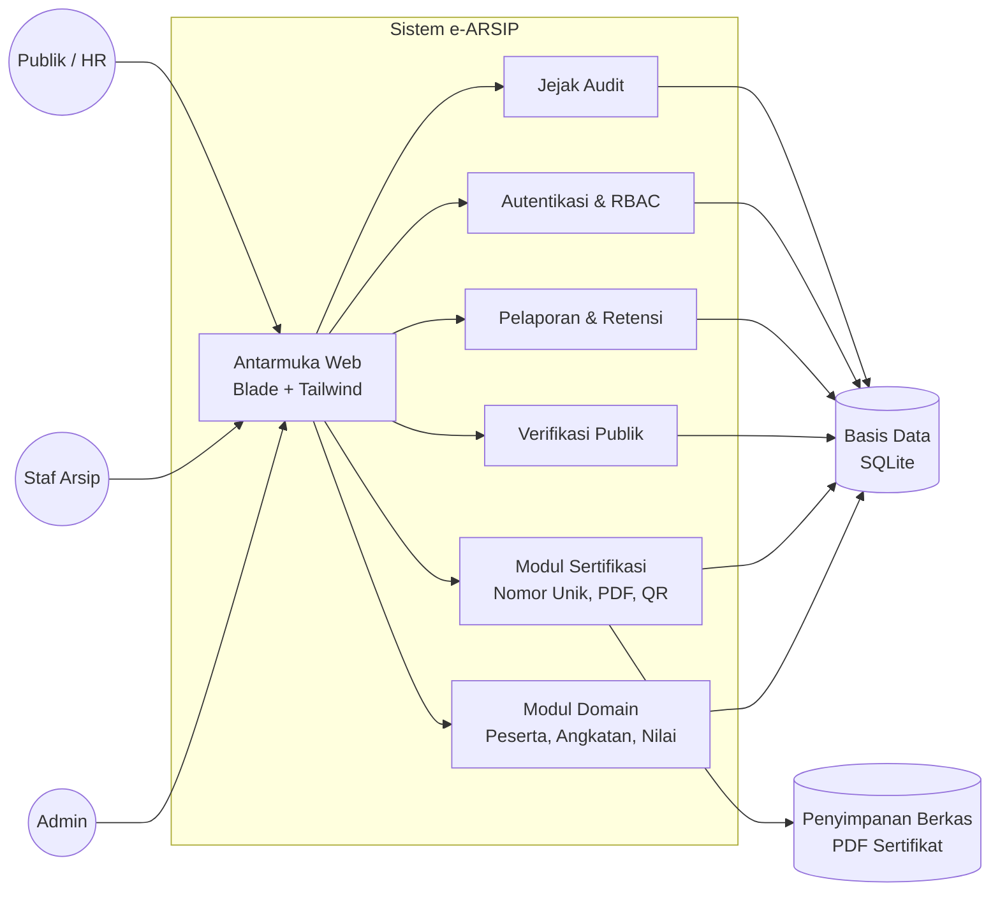

Penjelasan komponen:

- **Antarmuka web** menyediakan halaman login, dashboard, data peserta, sertifikasi, verifikasi, laporan, dan pengaturan.
- **Autentikasi dan RBAC** membatasi fungsi berdasarkan peran Admin dan Staf Arsip.
- **Modul domain** mengelola program, angkatan, peserta, enrollment, presensi, dan nilai.
- **Modul sertifikasi** mengalokasikan nomor unik, menghasilkan PDF, menanamkan QR, dan menyimpan hash berkas.
- **Verifikasi publik** membaca view data aman dan mencatat setiap permintaan.
- **Pelaporan dan retensi** menghasilkan rekap serta menjalankan kebijakan arsip.
- **Jejak audit** mencatat aksi penting secara append-only.
- **Basis data** menyimpan data relasional; **penyimpanan berkas** menyimpan PDF.

## 2.2 Fungsi Produk

**Tabel 2.1 Fungsi Produk**

| Kode | Fungsi | Deskripsi Umum | FR/Tiket |
| --- | --- | --- | --- |
| F-01 | Autentikasi dan Otorisasi | Login, logout, pembatasan akses berdasarkan peran, dan pemutusan sesi akun nonaktif. | ARSIP-003 |
| F-02 | Manajemen Pengguna | Admin menambah, mengubah, mengaktifkan, dan menonaktifkan akun staf/admin. | ARSIP-003 |
| F-03 | Manajemen Program dan Angkatan | CRUD program pelatihan, angkatan, kelas, kuota, dan periode. | ARSIP-004 |
| F-04 | Manajemen Peserta | CRUD biodata peserta, pendaftaran pada angkatan, pencarian multi-parameter, dan import data lama. | FR-01, ARSIP-005, ARSIP-006, ARSIP-007 |
| F-05 | Presensi dan Nilai | Pencatatan kehadiran per sesi, komponen nilai, bobot, nilai akhir, dan status kelulusan. | FR-01, FR-05 |
| F-06 | Penerbitan Sertifikat | Alokasi nomor unik, pemilihan template, pembuatan PDF, QR code, hash, dan gambar tanda tangan (bukan tanda tangan kriptografis/PKI). | FR-02 |
| F-07 | Verifikasi Publik | Pengecekan keaslian sertifikat melalui nomor unik tanpa login dan tanpa data sensitif. | FR-03 |
| F-08 | Pelaporan | Rekap kelulusan per program/periode dan ekspor PDF/Excel. | FR-05 |
| F-09 | Retensi Data | Kebijakan masa simpan, arsip dingin, dan soft delete. | FR-04 |
| F-10 | Penerbitan Ulang dan Audit | Pengajuan reissue, persetujuan, penerbitan sertifikat pengganti, dan jejak audit lengkap. | FR-06 |
| F-11 | Profil Pengguna | Perubahan kata sandi sendiri dengan verifikasi kata sandi lama. | ARSIP-003 |

Fungsi di atas menjelaskan kemampuan tingkat tinggi. Rincian alur diuraikan pada BAB III. Pada prototipe awal, F-01, F-02, F-07, dan F-11 sudah tersedia; fungsi lain masih dalam tahap perancangan.

## 2.3 Karakteristik Pengguna

**Tabel 2.2 Karakteristik Pengguna**

| Pengguna | Tanggung Jawab | Hak Akses | Tingkat Pendidikan | Keterampilan yang Dibutuhkan | Pengalaman | Jenis Pelatihan |
| --- | --- | --- | --- | --- | --- | --- |
| Admin | Mengelola akun, master data, kebijakan retensi, dan memastikan audit berjalan. | Seluruh fungsi, termasuk kelola pengguna, reissue, dan retensi. | Minimal D3/S1 | Literasi komputer, pemahaman alur arsip, dasar keamanan akun. | Minimal 1 tahun administrasi data | Pelatihan admin e-ARSIP dan kebijakan retensi |
| Staf Arsip | Menginput peserta, presensi, nilai, menerbitkan sertifikat, dan membuat laporan. | Data peserta, angkatan, presensi, nilai, sertifikat, laporan, dan pengajuan reissue. | SMA/SMK atau D3 | Penggunaan browser, spreadsheet, dan formulir web. | Minimal 6 bulan administrasi pelatihan | Pelatihan penggunaan e-ARSIP |
| Publik/HR | Memverifikasi keaslian sertifikat milik pelamar atau karyawan. | Hanya verifikasi publik; tanpa login. | Tidak dibatasi | Menggunakan browser dan memasukkan nomor sertifikat. | Tidak diperlukan | Tidak diperlukan |

## 2.4 Batasan-Batasan

**Tabel 2.3 Batasan-Batasan**

| Jenis Batasan | Uraian |
| --- | --- |
| Kebijakan organisasi | Data peserta bersifat rahasia; publik hanya boleh melihat nama, program, angkatan, dan tanggal terbit. Penerbitan ulang memerlukan alasan dan persetujuan. |
| Perangkat keras | Server minimal 2 vCPU, RAM 2 GB, dan penyimpanan 20 GB untuk prototipe. Klien minimal browser modern dengan layar 360 px ke atas. |
| Perangkat lunak | PHP 8.2+, Laravel 12, SQLite 3.35+ untuk prototipe, serta Node.js 22 untuk build aset. |
| Antarmuka eksternal | Verifikasi publik melalui URL HTTP/HTTPS dan QR code. Integrasi email/WhatsApp belum termasuk versi awal. |
| Platform | Aplikasi web responsif; target browser Chrome, Firefox, Edge, dan Safari versi terbaru. |
| Basis data | SQLite hanya mendukung satu penulis pada satu waktu; operasi tulis harus singkat. Jika beban tulis meningkat, migrasi ke PostgreSQL dipertimbangkan. |
| Waktu dan tim | Proyek dikerjakan dalam 12 minggu oleh tim kecil, sehingga prioritas menggunakan MoSCoW. |
| Legal dan privasi | Mengacu pada UU PDP; data pribadi tidak boleh tampil pada halaman publik; retensi harus dapat diaudit. |
| Keamanan | Wajib HTTPS di produksi, password di-hash, CSRF protection, rate limiting, dan validasi input. |

---

# BAB III ANALISA DAN PERANCANGAN

## 3.1 Analisa Kebutuhan Fungsional Perangkat Lunak

Kebutuhan fungsional diturunkan dari FR-01 sampai FR-06 dan tiket backlog. Pemetaan berikut memastikan setiap kebutuhan memiliki use case yang jelas.

**Tabel 3.1 Pemetaan Kebutuhan Fungsional ke Use Case**

| Kebutuhan | Use Case Terkait |
| --- | --- |
| FR-01 Data peserta | UC-03, UC-04, UC-05, UC-09 |
| FR-02 Sertifikasi | UC-06 |
| FR-03 Verifikasi publik | UC-07 |
| FR-04 Retensi data | UC-10 |
| FR-05 Pelaporan | UC-05, UC-09 |
| FR-06 Jejak audit dan reissue | UC-08 |
| ARSIP-003 Autentikasi | UC-01, UC-02, UC-12 |
| ARSIP-007 Import data lama | UC-11 |

### 3.1.1 Use Case Diagram

**Gambar 3.1 Use Case Diagram Sistem e-ARSIP**

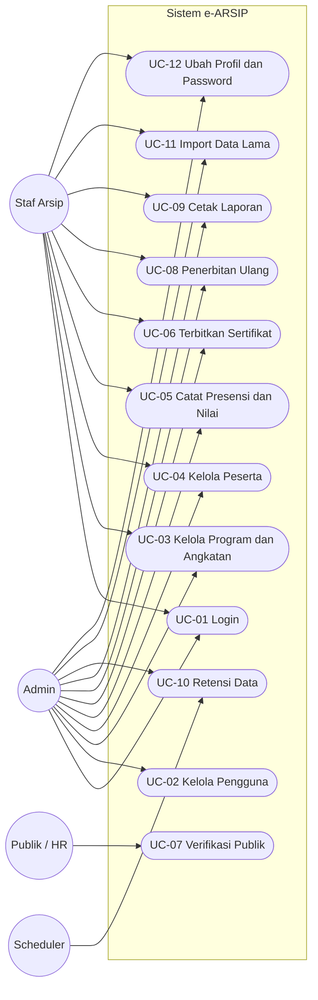

### 3.1.2 Use Case Specification

**Tabel 3.2 Daftar Use Case**

| ID | Nama Use Case | Aktor | Prioritas |
| --- | --- | --- | --- |
| UC-01 | Login | Admin, Staf Arsip | Must Have |
| UC-02 | Kelola Pengguna | Admin | Must Have |
| UC-03 | Kelola Program dan Angkatan | Admin, Staf Arsip | Must Have |
| UC-04 | Kelola Peserta | Admin, Staf Arsip | Must Have |
| UC-05 | Catat Presensi dan Nilai | Admin, Staf Arsip | Must Have |
| UC-06 | Terbitkan Sertifikat | Admin, Staf Arsip | Must Have |
| UC-07 | Verifikasi Publik | Publik/HR | Must Have |
| UC-08 | Penerbitan Ulang Sertifikat | Admin, Staf Arsip | Must Have |
| UC-09 | Cetak Laporan | Admin, Staf Arsip | Must Have |
| UC-10 | Retensi Data | Admin, Scheduler | Should Have |
| UC-11 | Import Data Lama | Admin, Staf Arsip | Should Have |
| UC-12 | Ubah Profil dan Password | Admin, Staf Arsip | Must Have |

#### UC-01 Login

**Tabel 3.3 Spesifikasi UC-01 Login**

| Elemen | Uraian |
| --- | --- |
| ID | UC-01 |
| Nama | Login |
| Deskripsi | Pengguna terdaftar masuk ke sistem menggunakan email dan kata sandi. |
| Aktor | Admin, Staf Arsip |
| Pre-condition | Akun terdaftar dan berstatus aktif. |
| Post-condition | Sesi login aktif, `last_login_at` diperbarui, dan audit `LOGIN` tercatat. |
| Basic Path | 1. Pengguna membuka `/login`.<br>2. Sistem menampilkan formulir email dan kata sandi.<br>3. Pengguna mengirim kredensial.<br>4. Sistem memvalidasi input dan batas percobaan.<br>5. Sistem memverifikasi kredensial dan status aktif.<br>6. Sistem membuat sesi serta mencatat waktu login dan audit.<br>7. Sistem mengarahkan pengguna ke dashboard. |
| Alternative Path | A1: Input tidak valid, sistem menampilkan pesan validasi.<br>A2: Kredensial salah atau akun nonaktif, sistem menolak login.<br>A3: Percobaan melebihi batas, sistem menampilkan pesan coba lagi nanti. |

#### UC-02 Kelola Pengguna

**Tabel 3.4 Spesifikasi UC-02 Kelola Pengguna**

| Elemen | Uraian |
| --- | --- |
| ID | UC-02 |
| Nama | Kelola Pengguna |
| Deskripsi | Admin mengelola akun Admin dan Staf Arsip. |
| Aktor | Admin |
| Pre-condition | Admin sudah login. |
| Post-condition | Data pengguna berubah dan audit `CREATE_USER`, `UPDATE_USER`, atau perubahan status tercatat. |
| Basic Path | 1. Admin membuka menu Pengguna.<br>2. Sistem menampilkan daftar pengguna.<br>3. Admin memilih tambah atau edit.<br>4. Sistem menampilkan formulir.<br>5. Admin mengisi nama, email, peran, status, dan kata sandi.<br>6. Sistem memvalidasi email unik, peran, dan kata sandi.<br>7. Sistem menyimpan data dan mencatat audit.<br>8. Sistem menampilkan status berhasil. |
| Alternative Path | A1: Email sudah dipakai, sistem menolak.<br>A2: Admin mencoba menonaktifkan atau menurunkan peran diri sendiri, sistem menolak.<br>A3: Pengguna non-admin membuka menu, sistem mengembalikan 403. |

#### UC-03 Kelola Program dan Angkatan

**Tabel 3.5 Spesifikasi UC-03 Kelola Program dan Angkatan**

| Elemen | Uraian |
| --- | --- |
| ID | UC-03 |
| Nama | Kelola Program dan Angkatan |
| Deskripsi | Pengguna mengelola master program pelatihan dan angkatan/kelas. |
| Aktor | Admin, Staf Arsip |
| Pre-condition | Pengguna sudah login. |
| Post-condition | Program atau angkatan tersimpan dan audit tercatat. |
| Basic Path | 1. Pengguna membuka menu Program.<br>2. Sistem menampilkan daftar program.<br>3. Pengguna menambah atau mengubah program: kode, nama, standar kompetensi, durasi, dan nilai minimum lulus.<br>4. Sistem memvalidasi kode unik dan nilai 0–100.<br>5. Pengguna menambah angkatan: program, kode batch, tahun, tanggal, kuota, lokasi, dan status.<br>6. Sistem memvalidasi tanggal dan relasi program.<br>7. Sistem menyimpan data dan mencatat audit. |
| Alternative Path | A1: Kode program atau batch sudah ada, sistem menolak.<br>A2: Tanggal selesai lebih awal dari tanggal mulai, sistem menolak.<br>A3: Program yang masih memiliki angkatan tidak dapat dihapus permanen. |

#### UC-04 Kelola Peserta

**Tabel 3.6 Spesifikasi UC-04 Kelola Peserta**

| Elemen | Uraian |
| --- | --- |
| ID | UC-04 |
| Nama | Kelola Peserta |
| Deskripsi | Pengguna mengelola biodata peserta, pendaftaran pada angkatan, pencarian, dan import data lama. |
| Aktor | Admin, Staf Arsip |
| Pre-condition | Program dan angkatan sudah tersedia. |
| Post-condition | Data peserta dan enrollment tersimpan, dapat dicari, dan audit tercatat. |
| Basic Path | 1. Pengguna membuka menu Data Peserta.<br>2. Sistem menampilkan daftar dan filter.<br>3. Pengguna memilih tambah, edit, cari, atau import.<br>4. Pengguna mengisi NIK, nama, biodata, kontak, dan instansi.<br>5. Pengguna memilih angkatan, nomor peserta, status pendaftaran, dan status kelulusan.<br>6. Sistem memvalidasi NIK 16 digit, keunikan NIK, dan relasi angkatan.<br>7. Sistem menyimpan participant dan enrollment.<br>8. Sistem mencatat audit dan menampilkan hasil. |
| Alternative Path | A1: NIK tidak valid atau sudah terdaftar, sistem menolak atau mengarahkan ke data existing.<br>A2: Pencarian tidak menemukan data, sistem menampilkan hasil kosong.<br>A3: Import memiliki baris invalid, sistem menyimpan baris valid dan mencatat error per baris. |

#### UC-05 Catat Presensi dan Nilai

**Tabel 3.7 Spesifikasi UC-05 Catat Presensi dan Nilai**

| Elemen | Uraian |
| --- | --- |
| ID | UC-05 |
| Nama | Catat Presensi dan Nilai |
| Deskripsi | Pengguna mencatat kehadiran peserta per sesi dan nilai per komponen penilaian. |
| Aktor | Admin, Staf Arsip |
| Pre-condition | Peserta terdaftar pada angkatan dan komponen nilai sudah ditetapkan. |
| Post-condition | Presensi dan nilai tersimpan; nilai akhir serta status kelulusan diperbarui. |
| Basic Path | 1. Pengguna memilih angkatan dan sesi.<br>2. Sistem menampilkan daftar peserta.<br>3. Pengguna mengisi status presensi: hadir, izin, sakit, atau alpa.<br>4. Sistem menyimpan presensi dan audit.<br>5. Pengguna memilih komponen nilai dan mengisi nilai 0–100.<br>6. Sistem memvalidasi rentang nilai dan bobot.<br>7. Sistem menghitung nilai akhir serta status kelulusan.<br>8. Sistem menyimpan nilai dan audit. |
| Alternative Path | A1: Nilai di luar 0–100, sistem menolak.<br>A2: Total bobot komponen tidak 100, sistem menampilkan peringatan.<br>A3: Peserta tidak terdaftar pada angkatan, sistem menolak input. |

#### UC-06 Terbitkan Sertifikat

**Tabel 3.8 Spesifikasi UC-06 Terbitkan Sertifikat**

| Elemen | Uraian |
| --- | --- |
| ID | UC-06 |
| Nama | Terbitkan Sertifikat |
| Deskripsi | Pengguna menerbitkan sertifikat PDF bernomor unik untuk peserta yang lulus. |
| Aktor | Admin, Staf Arsip |
| Pre-condition | Peserta berstatus lulus, template aktif tersedia, dan belum ada sertifikat aktif untuk enrollment tersebut. |
| Post-condition | Sertifikat aktif tersimpan, PDF dihasilkan, dan audit `ISSUE_CERTIFICATE` tercatat. |
| Basic Path | 1. Pengguna memilih angkatan.<br>2. Sistem menampilkan peserta lulus yang belum memiliki sertifikat aktif.<br>3. Pengguna memilih peserta dan template.<br>4. Sistem memulai transaksi dan mengalokasikan nomor unik.<br>5. Sistem membuat PDF dengan data peserta, program, QR token, dan hash.<br>6. Sistem menyimpan berkas dan data sertifikat berstatus aktif.<br>7. Sistem mencatat audit.<br>8. Sistem menampilkan tautan unduh. |
| Alternative Path | A1: Peserta belum lulus, sistem menolak.<br>A2: Sudah ada sertifikat aktif, sistem menolak penerbitan ganda.<br>A3: Nomor bentrok, sistem mengulang alokasi dalam transaksi.<br>A4: Template tidak aktif, sistem meminta memilih template lain. |

#### UC-07 Verifikasi Publik

**Tabel 3.9 Spesifikasi UC-07 Verifikasi Publik**

| Elemen | Uraian |
| --- | --- |
| ID | UC-07 |
| Nama | Verifikasi Publik |
| Deskripsi | Publik memeriksa keaslian sertifikat menggunakan nomor sertifikat. |
| Aktor | Publik/HR |
| Pre-condition | Tidak diperlukan login. |
| Post-condition | Hasil verifikasi ditampilkan dan `verification_logs` tercatat. |
| Basic Path | 1. Publik membuka `/verify`.<br>2. Sistem menampilkan formulir nomor sertifikat.<br>3. Publik mengirim nomor.<br>4. Sistem memvalidasi input dan rate limit.<br>5. Sistem mencari nomor pada view publik.<br>6. Sistem menentukan status valid, dibatalkan, atau tidak ditemukan.<br>7. Sistem mencatat log verifikasi.<br>8. Sistem menampilkan nama, program, angkatan, tanggal terbit, dan status. |
| Alternative Path | A1: Nomor tidak ditemukan, sistem menampilkan pesan tidak ditemukan.<br>A2: Sertifikat dibatalkan atau diganti, sistem menampilkan status tidak berlaku.<br>A3: Rate limit terlampaui, sistem menolak sementara. |

#### UC-08 Penerbitan Ulang Sertifikat

**Tabel 3.10 Spesifikasi UC-08 Penerbitan Ulang Sertifikat**

| Elemen | Uraian |
| --- | --- |
| ID | UC-08 |
| Nama | Penerbitan Ulang Sertifikat |
| Deskripsi | Pengguna mengajukan dan memproses penerbitan ulang sertifikat dengan alasan yang tercatat. |
| Aktor | Admin, Staf Arsip |
| Pre-condition | Sertifikat asal ada dan pengguna sudah login. |
| Post-condition | Sertifikat lama berstatus diganti, sertifikat baru aktif, dan audit `REISSUE` tercatat. |
| Basic Path | 1. Pengguna membuka detail sertifikat.<br>2. Pengguna memilih ajukan penerbitan ulang.<br>3. Pengguna mengisi alasan, nama, dan kontak pemohon.<br>4. Sistem menyimpan permohonan berstatus diajukan dan audit.<br>5. Admin menyetujui permohonan.<br>6. Sistem memulai transaksi dan menonaktifkan sertifikat lama.<br>7. Sistem mengalokasikan nomor baru dan membuat PDF baru.<br>8. Sistem menyimpan sertifikat baru, menautkan pengganti, dan menyelesaikan permohonan.<br>9. Sistem mencatat audit dan menampilkan hasil. |
| Alternative Path | A1: Alasan kosong, sistem menolak.<br>A2: Permohonan ditolak, status menjadi ditolak dan audit tercatat.<br>A3: Sertifikat asal sudah tidak aktif, sistem menolak.<br>A4: Terjadi kegagalan saat membuat PDF, transaksi dibatalkan. |

#### UC-09 Cetak Laporan

**Tabel 3.11 Spesifikasi UC-09 Cetak Laporan**

| Elemen | Uraian |
| --- | --- |
| ID | UC-09 |
| Nama | Cetak Laporan |
| Deskripsi | Pengguna membuat rekap kelulusan per program/periode dan mengekspornya. |
| Aktor | Admin, Staf Arsip |
| Pre-condition | Data peserta, nilai, dan sertifikat tersedia. |
| Post-condition | Laporan ditampilkan atau diekspor, dan audit `EXPORT` tercatat. |
| Basic Path | 1. Pengguna membuka menu Laporan.<br>2. Pengguna memilih program, angkatan, dan periode.<br>3. Sistem mengambil data enrollment, nilai, dan sertifikat.<br>4. Sistem menghitung status lulus dan tidak lulus.<br>5. Sistem menampilkan pratinjau rekap.<br>6. Pengguna memilih ekspor PDF atau Excel.<br>7. Sistem menghasilkan berkas dan mencatat audit. |
| Alternative Path | A1: Tidak ada data pada filter, sistem menampilkan pesan kosong.<br>A2: Nilai belum lengkap, sistem menandai peserta sebagai belum dinilai.<br>A3: Ekspor gagal, sistem menampilkan error dan tidak mencatat keberhasilan. |

#### UC-10 Retensi Data

**Tabel 3.12 Spesifikasi UC-10 Retensi Data**

| Elemen | Uraian |
| --- | --- |
| ID | UC-10 |
| Nama | Retensi Data |
| Deskripsi | Sistem menjalankan kebijakan masa simpan dan memindahkan atau menandai data lama. |
| Aktor | Admin, Scheduler |
| Pre-condition | Kebijakan retensi aktif tersedia. |
| Post-condition | Data lama diarsipkan, dipindahkan ke cold storage, atau di-soft-delete; audit tercatat. |
| Basic Path | 1. Scheduler harian berjalan.<br>2. Sistem membaca kebijakan retensi aktif.<br>3. Sistem menghitung umur data berdasarkan basis kebijakan.<br>4. Jika melewati batas, sistem menjalankan aksi yang ditetapkan.<br>5. Sistem mencatat audit dan ringkasan hasil. |
| Alternative Path | A1: Tidak ada kebijakan aktif, proses dilewati.<br>A2: Berkas gagal dipindahkan, sistem mencatat error dan mencoba lagi pada jadwal berikutnya.<br>A3: Data masih diperlukan untuk audit, admin menonaktifkan kebijakan sementara. |

#### UC-11 Import Data Lama

**Tabel 3.13 Spesifikasi UC-11 Import Data Lama**

| Elemen | Uraian |
| --- | --- |
| ID | UC-11 |
| Nama | Import Data Lama |
| Deskripsi | Pengguna mengimpor data peserta, nilai, atau sertifikat lama dari Excel/CSV. |
| Aktor | Admin, Staf Arsip |
| Pre-condition | Berkas sesuai format dan pengguna sudah login. |
| Post-condition | Baris valid tersimpan, baris invalid dilaporkan, dan status import tercatat. |
| Basic Path | 1. Pengguna membuka menu Import.<br>2. Pengguna mengunggah berkas Excel/CSV.<br>3. Sistem memvalidasi header dan format.<br>4. Sistem memproses setiap baris: validasi NIK, duplikat, dan relasi.<br>5. Sistem menyimpan baris valid dan mengumpulkan error baris invalid.<br>6. Sistem memperbarui status import dan mencatat audit.<br>7. Sistem menampilkan ringkasan berhasil dan gagal. |
| Alternative Path | A1: Format berkas salah, sistem menolak seluruh berkas.<br>A2: Sebagian baris duplikat, sistem melewati atau memperbarui sesuai pilihan.<br>A3: Terjadi kegagalan di tengah proses, sistem mencatat status `selesai_dengan_error`. |

#### UC-12 Ubah Profil dan Password

**Tabel 3.14 Spesifikasi UC-12 Ubah Profil dan Password**

| Elemen | Uraian |
| --- | --- |
| ID | UC-12 |
| Nama | Ubah Profil dan Password |
| Deskripsi | Pengguna melihat informasi akun dan mengubah kata sandi sendiri. |
| Aktor | Admin, Staf Arsip |
| Pre-condition | Pengguna sudah login. |
| Post-condition | Kata sandi baru tersimpan dan audit `PASSWORD_CHANGE` tercatat. |
| Basic Path | 1. Pengguna membuka halaman Profil.<br>2. Sistem menampilkan informasi akun.<br>3. Pengguna mengisi kata sandi saat ini, kata sandi baru, dan konfirmasi.<br>4. Sistem memverifikasi kata sandi saat ini.<br>5. Sistem memvalidasi panjang dan konfirmasi.<br>6. Sistem menyimpan hash kata sandi baru dan mencatat audit.<br>7. Sistem menampilkan pesan berhasil. |
| Alternative Path | A1: Kata sandi saat ini salah, sistem menolak.<br>A2: Konfirmasi tidak cocok, sistem menampilkan error.<br>A3: Kata sandi kurang dari 8 karakter, sistem menolak. |

### 3.1.3 Activity Diagram

#### Activity Diagram Login

**Gambar 3.2 Activity Diagram Login**

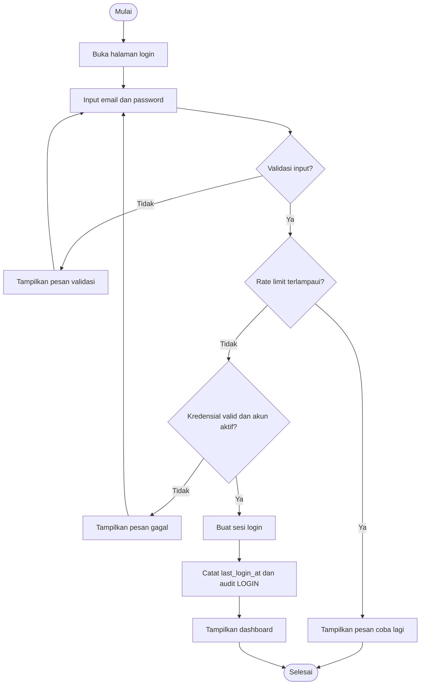

#### Activity Diagram Kelola Peserta

**Gambar 3.3 Activity Diagram Kelola Peserta**

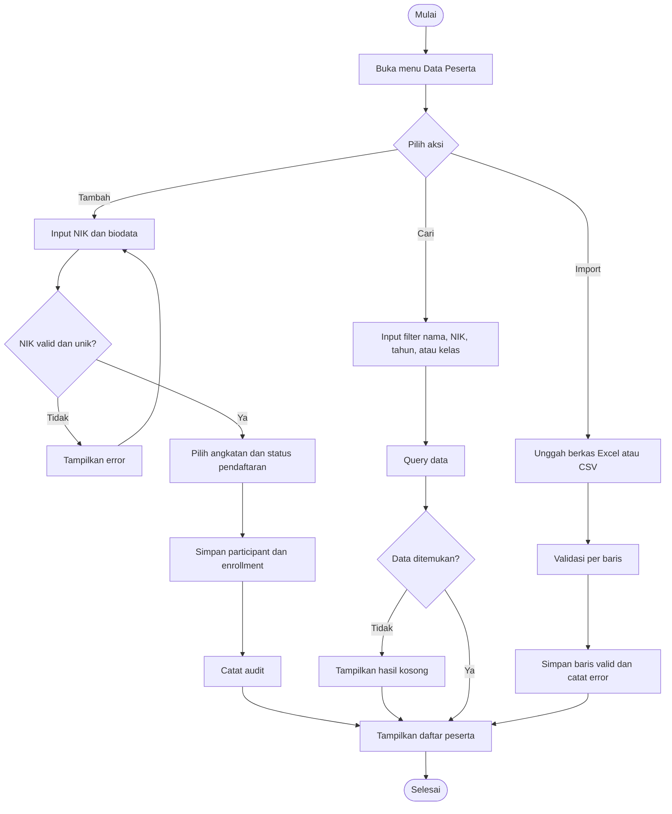

#### Activity Diagram Catat Presensi dan Nilai

**Gambar 3.4 Activity Diagram Catat Presensi dan Nilai**

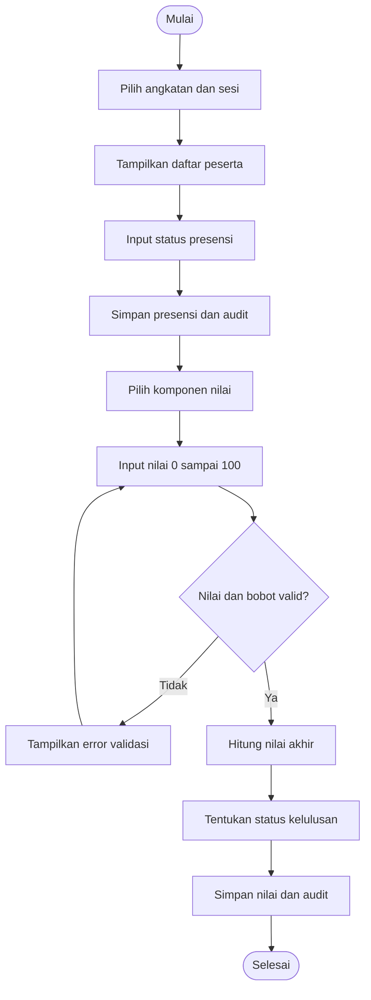

#### Activity Diagram Terbitkan Sertifikat

**Gambar 3.5 Activity Diagram Terbitkan Sertifikat**

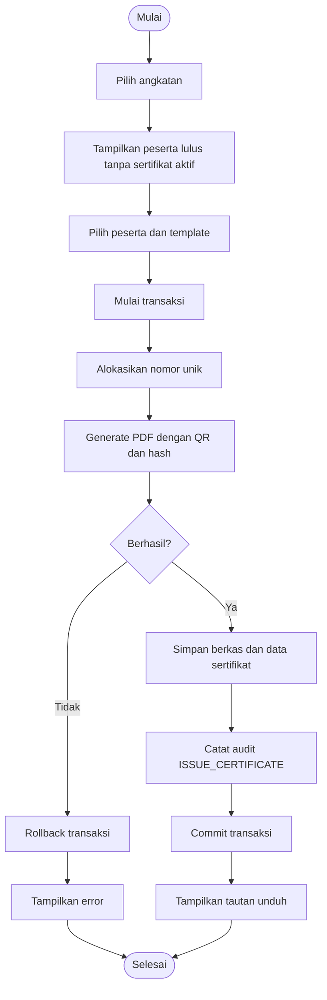

#### Activity Diagram Verifikasi Publik

**Gambar 3.6 Activity Diagram Verifikasi Publik**

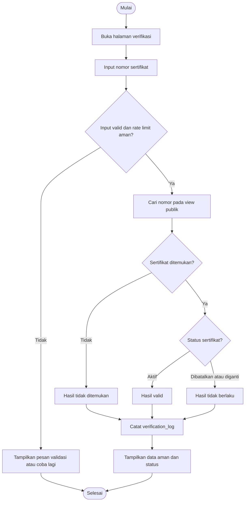

#### Activity Diagram Penerbitan Ulang Sertifikat

**Gambar 3.7 Activity Diagram Penerbitan Ulang Sertifikat**

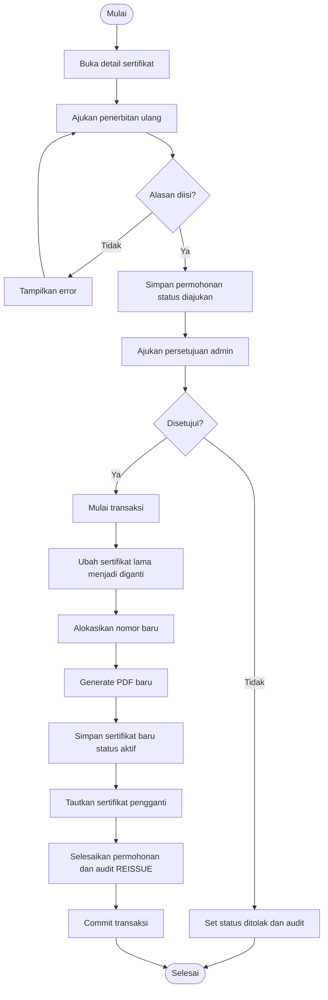

#### Activity Diagram Retensi Data

**Gambar 3.8 Activity Diagram Retensi Data**

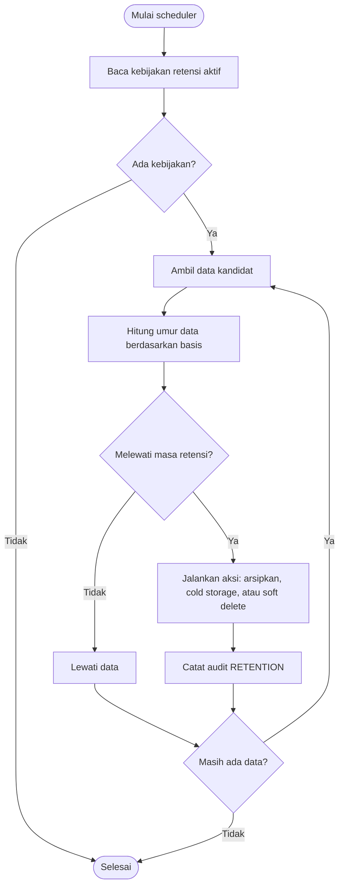

## 3.2 Analisa Kebutuhan Non Fungsional

**Tabel 3.15 Kebutuhan Non Fungsional**

| ID | Kategori | Kebutuhan | Target atau Ukuran |
| --- | --- | --- | --- |
| NFR-01 | Performance | Pencarian peserta multi-parameter harus cepat. | Kurang dari 3 detik untuk 10.000 peserta pada perangkat staf. |
| NFR-02 | Performance | Halaman utama dan verifikasi harus responsif. | Waktu muat kurang dari 2 detik pada jaringan lokal. |
| NFR-03 | Scalability | Sistem menangani data dan pengguna lembaga. | 10.000 peserta, 5.000 sertifikat, 20 pengguna aktif bersamaan untuk operasi baca. |
| NFR-04 | Security | Akses harus dibatasi berdasarkan peran. | RBAC Admin dan Staf; endpoint admin mengembalikan 403 untuk staf. |
| NFR-05 | Security | Kredensial dan sesi harus aman. | Password di-hash; CSRF aktif; login dibatasi 5 percobaan per menit; verifikasi 20 permintaan per menit. |
| NFR-06 | Privacy | Data publik harus diminimalkan. | Hanya nama, program, angkatan, tanggal terbit, dan status. NIK, alamat, email, dan kontak tidak tampil. |
| NFR-07 | Reliability | Data harus dapat dipulihkan. | Backup harian; RPO 24 jam; RTO 4 jam; audit append-only. |
| NFR-08 | Availability | Sistem tersedia pada jam kerja. | 99% ketersediaan pada jam operasional; pemeliharaan di luar jam kerja. |
| NFR-09 | Usability | Antarmuka mudah dipahami staf. | Bahasa Indonesia, responsif 360 px ke atas, verifikasi maksimal 3 langkah. |
| NFR-10 | Accessibility | Formulir dan navigasi dapat digunakan dengan baik. | Label input, kontras memadai, fokus keyboard terlihat, pesan error jelas. |
| NFR-11 | Maintainability | Kode mudah dirawat dan diuji. | Konvensi Laravel, Laravel Pint, automated test, CI, dokumentasi ERD. |
| NFR-12 | Compatibility | Berjalan pada lingkungan yang ditetapkan. | PHP 8.2+, SQLite 3.35+, Chrome/Firefox/Edge/Safari versi terbaru, Linux server. |
| NFR-13 | Portability | Data dan aplikasi dapat dipindahkan. | Backup berkas SQLite; skema mudah diport ke PostgreSQL. |
| NFR-14 | Legal | Mematuhi pelindungan data pribadi dan retensi. | Sesuai UU PDP; data lama diarsipkan atau dihapus sesuai kebijakan. |
| NFR-15 | Observability | Aktivitas penting dapat ditelusuri. | Audit login, CRUD, penerbitan, reissue, ekspor, dan log verifikasi. |

## 3.3 Perancangan

### 3.3.1 Sequence Diagram

#### Sequence Diagram Login

**Gambar 3.9 Sequence Diagram Login**

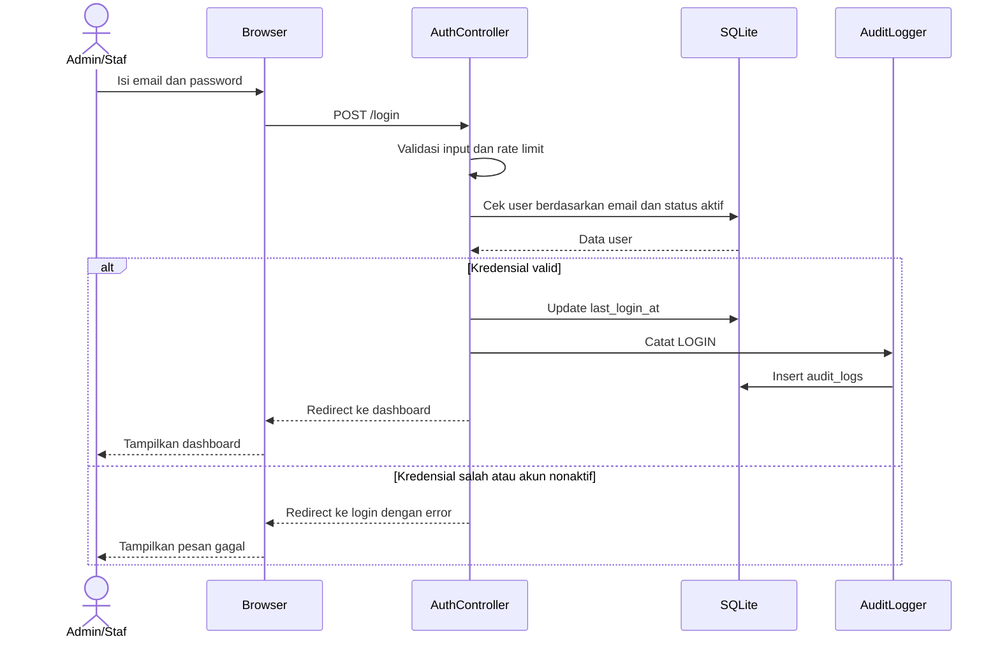

#### Sequence Diagram Verifikasi Publik

**Gambar 3.10 Sequence Diagram Verifikasi Publik**

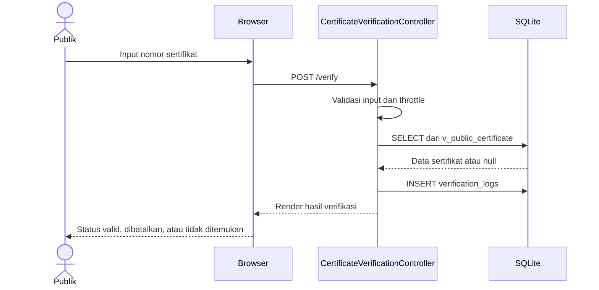

#### Sequence Diagram Terbitkan Sertifikat

**Gambar 3.11 Sequence Diagram Terbitkan Sertifikat**

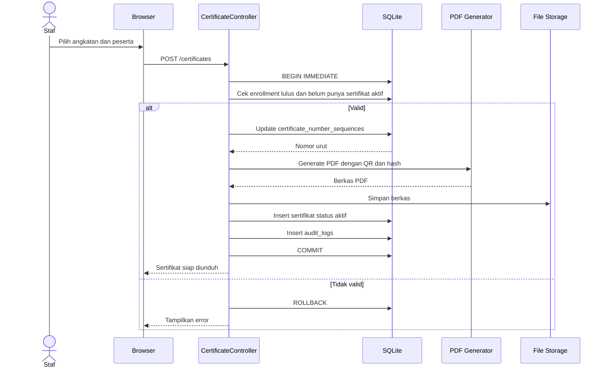

#### Sequence Diagram Penerbitan Ulang

**Gambar 3.12 Sequence Diagram Penerbitan Ulang**

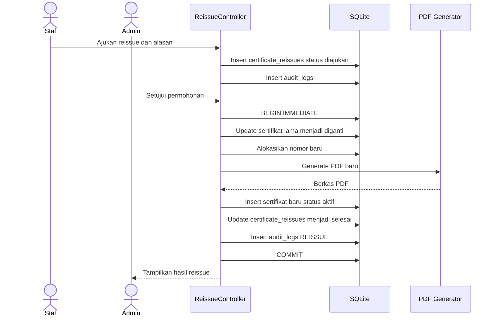

### 3.3.2 Perancangan Data

Perancangan data dibagi menjadi tiga tingkat:

1. **Konseptual:** entitas utama dan relasinya.
2. **Logis:** tabel, primary key, foreign key, dan kardinalitas.
3. **Fisik:** tipe data SQLite, index, partial unique index, view, dan trigger.

**Gambar 3.13 ERD Inti Sistem e-ARSIP**

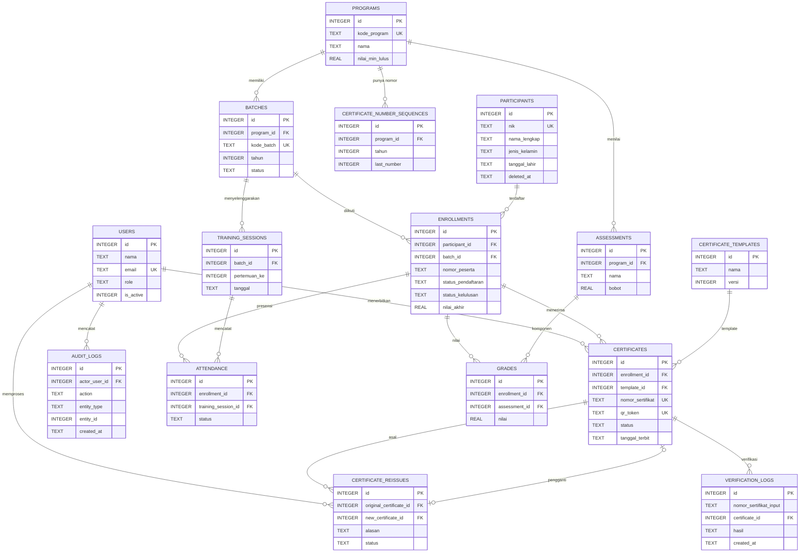

**Tabel 3.16 Ringkasan Tabel Database**

| Tabel | Fungsi | Relasi Utama |
| --- | --- | --- |
| users | Akun Admin dan Staf Arsip | ke certificates, reissues, audit_logs |
| sessions | Sesi login bawaan Laravel | ke users |
| programs | Master program pelatihan | ke batches, assessments, sequences |
| batches | Angkatan/kelas per program | ke enrollments, training_sessions |
| participants | Master biodata peserta | ke enrollments |
| enrollments | Pendaftaran peserta pada angkatan | ke attendance, grades, certificates |
| training_sessions | Sesi/pertemuan pelatihan | ke attendance |
| attendance | Presensi per peserta per sesi | ke enrollments, training_sessions |
| assessments | Komponen nilai dan bobot | ke grades |
| grades | Nilai peserta per komponen | ke enrollments, assessments |
| certificate_templates | Template desain sertifikat | ke certificates |
| certificate_number_sequences | Penghitung nomor unik per program/tahun | ke programs |
| certificates | Sertifikat terbit | ke enrollments, templates, reissues |
| certificate_reissues | Riwayat penerbitan ulang | ke certificates |
| audit_logs | Jejak audit append-only | ke users |
| verification_logs | Log verifikasi publik | ke certificates |
| retention_policies | Kebijakan retensi | ke users |
| data_imports | Riwayat import Excel/CSV | ke users |

**Tabel 3.17 Struktur Tabel users**

| Kolom | Tipe | Constraint | Keterangan |
| --- | --- | --- | --- |
| id | INTEGER | PK | ID internal |
| nama | TEXT | NOT NULL | Nama lengkap |
| email | TEXT | NOT NULL, unik case-insensitive | Login pengguna |
| password | TEXT | NOT NULL | Hash kata sandi |
| role | TEXT | NOT NULL, CHECK admin atau staf_arsip | Peran RBAC |
| is_active | INTEGER | NOT NULL, default 1 | Status akun |
| last_login_at | TEXT | NULL | Waktu login terakhir |
| created_at, updated_at | TEXT | NOT NULL | Timestamp |
| deleted_at | TEXT | NULL | Soft delete |

**Tabel 3.18 Struktur Tabel participants**

| Kolom | Tipe | Constraint | Keterangan |
| --- | --- | --- | --- |
| id | INTEGER | PK | ID internal |
| nik | TEXT | NOT NULL, UNIQUE, 16 digit | Nomor kependudukan |
| nama_lengkap | TEXT | NOT NULL | Nama peserta |
| jenis_kelamin | TEXT | CHECK L atau P | Jenis kelamin |
| tanggal_lahir | TEXT | NULL | Tanggal lahir |
| alamat | TEXT | NULL | Tidak tampil publik |
| email | TEXT | NULL, unik case-insensitive | Kontak |
| no_telepon | TEXT | NULL | Kontak |
| instansi | TEXT | NULL | Instansi peserta |
| archived_at | TEXT | NULL | Waktu arsip |
| storage_tier | TEXT | hot atau cold | Tingkat penyimpanan |
| deleted_at | TEXT | NULL | Soft delete |

**Tabel 3.19 Struktur Tabel enrollments**

| Kolom | Tipe | Constraint | Keterangan |
| --- | --- | --- | --- |
| id | INTEGER | PK | ID internal |
| participant_id | INTEGER | FK participants, NOT NULL | Peserta |
| batch_id | INTEGER | FK batches, NOT NULL | Angkatan |
| nomor_peserta | TEXT | NULL | Nomor dalam angkatan |
| status_pendaftaran | TEXT | CHECK terdaftar, aktif, mengundurkan_diri, selesai, dibatalkan | Status proses |
| status_kelulusan | TEXT | CHECK belum_dinilai, lulus, tidak_lulus | Hasil akhir |
| tanggal_daftar | TEXT | NOT NULL | Tanggal daftar |
| nilai_akhir | REAL | 0–100 | Nilai terbobot |
| deleted_at | TEXT | NULL | Soft delete |

Unik parsial: satu peserta hanya boleh punya satu enrollment aktif per angkatan.

**Tabel 3.20 Struktur Tabel certificates**

| Kolom | Tipe | Constraint | Keterangan |
| --- | --- | --- | --- |
| id | INTEGER | PK | ID internal |
| enrollment_id | INTEGER | FK enrollments, NOT NULL | Penerima |
| template_id | INTEGER | FK certificate_templates, NOT NULL | Template |
| nomor_sertifikat | TEXT | NOT NULL, UNIQUE | Nomor unik |
| qr_token | TEXT | NOT NULL, UNIQUE | Token verifikasi |
| file_path | TEXT | NULL | Lokasi PDF |
| file_hash | TEXT | NOT NULL | SHA-256 berkas |
| status | TEXT | CHECK aktif, dibatalkan, diganti | Status legalitas |
| tanggal_terbit | TEXT | NOT NULL | Tanggal terbit |
| diterbitkan_oleh | INTEGER | FK users, NULL | Staf penerbit |
| dibatalkan_at | TEXT | NULL | Waktu pembatalan |
| alasan_pembatalan | TEXT | NULL | Alasan |
| replaced_by_id | INTEGER | FK certificates, NULL | Sertifikat pengganti |

Index unik parsial: hanya satu sertifikat berstatus `aktif` per enrollment.

**Tabel 3.21 Struktur Tabel certificate_reissues**

| Kolom | Tipe | Constraint | Keterangan |
| --- | --- | --- | --- |
| id | INTEGER | PK | ID internal |
| original_certificate_id | INTEGER | FK certificates, NOT NULL | Sertifikat asal |
| new_certificate_id | INTEGER | FK certificates, NULL, UNIQUE | Sertifikat pengganti |
| alasan | TEXT | NOT NULL | Alasan reissue |
| pemohon_nama | TEXT | NULL | Nama pemohon |
| pemohon_kontak | TEXT | NULL | Kontak pemohon |
| status | TEXT | CHECK diajukan, disetujui, ditolak, selesai | Status permohonan |
| diproses_oleh | INTEGER | FK users, NOT NULL | Staf pemroses |
| disetujui_oleh | INTEGER | FK users, NULL | Penyetuju |
| created_at, decided_at, completed_at | TEXT | NULL atau NOT NULL | Jejak waktu |

**Tabel 3.22 Struktur Tabel audit_logs**

| Kolom | Tipe | Constraint | Keterangan |
| --- | --- | --- | --- |
| id | INTEGER | PK | ID internal |
| actor_user_id | INTEGER | FK users, NULL | Pelaku; null untuk aksi publik |
| action | TEXT | NOT NULL | Jenis aksi |
| entity_type | TEXT | NOT NULL | Nama entitas |
| entity_id | INTEGER | NULL | ID entitas |
| before_data | TEXT | JSON, NULL | Snapshot sebelum |
| after_data | TEXT | JSON, NULL | Snapshot sesudah |
| ip_address | TEXT | NULL | IP pelaku |
| user_agent | TEXT | NULL | Klien |
| request_id | TEXT | NULL | Korelasi request |
| created_at | TEXT | NOT NULL | Waktu aksi |

Trigger SQLite memblokir `UPDATE` dan `DELETE` pada tabel ini.

**Tabel 3.23 Aturan Integritas Data**

| Aturan | Implementasi |
| --- | --- |
| NIK unik | Unique index pada `participants.nik` |
| Nomor sertifikat unik | Unique index pada `certificates.nomor_sertifikat` |
| Satu sertifikat aktif per enrollment | Partial unique index `WHERE status = 'aktif'` |
| Satu enrollment per peserta per angkatan | Partial unique index `WHERE deleted_at IS NULL` |
| Nomor peserta unik per angkatan | Partial unique index pada `batch_id, nomor_peserta` |
| Email unik case-insensitive | Unique index pada `lower(email)` |
| Audit tidak dapat diubah | Trigger `BEFORE UPDATE` dan `BEFORE DELETE` |
| Data publik aman | View `v_public_certificate` hanya memuat kolom aman |
| Retensi | Kolom `archived_at`, `storage_tier`, `deleted_at`, dan `retention_policies` |
| Foreign key | `RESTRICT`, `CASCADE`, atau `SET NULL` sesuai relasi |

Catatan fisik SQLite:

- Tipe data mengikuti storage class `INTEGER`, `TEXT`, `REAL`, dan `BLOB`.
- Boolean disimpan sebagai `INTEGER` 0/1.
- Tanggal disimpan sebagai `TEXT` agar mudah diurutkan dan dibackup.
- JSON disimpan sebagai `TEXT` dan diolah aplikasi.
- `PRAGMA foreign_keys = ON` wajib aktif.
- Untuk produksi, aktifkan `PRAGMA journal_mode = WAL` dan `PRAGMA busy_timeout`.
- SQLite hanya satu penulis; transaksi penerbitan dan reissue harus singkat.

### 3.3.3 Perancangan Antarmuka Pengguna

Perancangan antarmuka mengikuti prinsip berikut:

- Bahasa Indonesia, istilah konsisten, dan pesan error yang jelas.
- Navigasi utama: Verifikasi, Dashboard, Profil, Pengguna (khusus Admin), dan Keluar.
- Warna utama hijau emerald untuk aksi positif, merah untuk pembatalan, dan amber untuk peringatan.
- Layout responsif: satu kolom pada ponsel, dua kolom pada desktop.
- Formulir memiliki label, status fokus, dan pesan validasi di dekat input.
- Halaman publik tidak menampilkan NIK, alamat, email, atau kontak.

**Gambar 3.14 Wireframe Halaman Login**

```text
+------------------------------------------------------+
|  e-ARSIP                                             |
+------------------------------------------------------+
|                                                      |
|              Masuk ke e-ARSIP                        |
|       Gunakan akun staf yang telah terdaftar.        |
|                                                      |
|   Email       [...................................]  |
|   Kata sandi  [...................................]  |
|   [x] Ingat saya                                     |
|                                                      |
|   [                 Masuk                 ]          |
|                                                      |
+------------------------------------------------------+
```

**Gambar 3.15 Wireframe Dashboard**

```text
+------------------------------------------------------------------+
| e-ARSIP    Verifikasi   Dashboard   Profil   Pengguna   Keluar    |
+------------------------------------------------------------------+
| Dashboard                                                        |
| Selamat datang, [Nama]. Peran Anda: Admin.                       |
|                                                                  |
| [ Peserta ]   [ Angkatan ]   [ Sertifikat Aktif ]  [ Reissue ]   |
|     120            8                95                 2          |
|                                                                  |
| Modul yang siap dikembangkan                                      |
| - Data Peserta       CRUD peserta, angkatan, presensi, nilai      |
| - Sertifikasi        Nomor unik, PDF, QR, gambar tanda tangan            |
| - Verifikasi Publik  Halaman publik dan log verifikasi            |
+------------------------------------------------------------------+
```

**Gambar 3.16 Wireframe Data Peserta**

```text
+------------------------------------------------------------------+
| Data Peserta                              [+ Tambah] [Import]     |
+------------------------------------------------------------------+
| Nama [..............]  NIK [..............]                       |
| Tahun [2026 v]  Kelas [2026-01 v]  [ Cari ]                       |
+------------------------------------------------------------------+
| NIK        | Nama           | Angkatan | Kelas   | Status | Aksi  |
| 3201...001 | Budi Santoso   | 2026     | 2026-01 | Lulus  | Edit  |
| 3201...002 | Siti Aminah    | 2026     | 2026-01 | Aktif  | Edit  |
+------------------------------------------------------------------+
| Menampilkan 1-15 dari 120 data                         [<] [>]    |
+------------------------------------------------------------------+
```

**Gambar 3.17 Wireframe Terbitkan Sertifikat**

```text
+------------------------------------------------------------------+
| Terbitkan Sertifikat                                             |
+------------------------------------------------------------------+
| Program  [ Pelatihan Kepemimpinan Dasar v ]                      |
| Angkatan [ 2026-01 v ]     Template [ Default v ]                |
+------------------------------------------------------------------+
| [ ] | Peserta        | Nilai | Status | Sertifikat Aktif         |
| [x] | Budi Santoso   | 86.50 | Lulus  | Belum ada                |
| [ ] | Siti Aminah    | 78.00 | Lulus  | PEL/2026/0002            |
+------------------------------------------------------------------+
| [ Generate dan Unduh PDF ]                                       |
+------------------------------------------------------------------+
```

**Gambar 3.18 Wireframe Verifikasi Publik**

```text
+------------------------------------------------------------------+
| Verifikasi Sertifikat                                            |
| Masukkan nomor sertifikat untuk memeriksa keasliannya.           |
|                                                                  |
| [ PEL/2026/0001.......................... ]  [ Verifikasi ]      |
+------------------------------------------------------------------+
| Status: VALID                                                    |
| Nama          : Budi Santoso                                     |
| Program       : Pelatihan Kepemimpinan Dasar                     |
| Angkatan      : 2026-01 (2026)                                   |
| Tanggal terbit: 10 Februari 2026                                 |
+------------------------------------------------------------------+
| Hanya nama, program, angkatan, dan tanggal terbit yang tampil.   |
+------------------------------------------------------------------+
```

---

# LAMPIRAN

## Lampiran A Dokumen Wawancara

Dokumen ini wajib diisi berdasarkan wawancara nyata. Untuk keabsahan, bubuhkan tanda tangan pewawancara dan narasumber.

**Tabel A.1 Format Dokumen Wawancara**

| Elemen | Isi |
| --- | --- |
| Pewawancara | [Nama] |
| Narasumber | [Nama dan jabatan] |
| Tanggal dan waktu | [Tanggal, jam] |
| Lokasi | [Tempat] |
| Topik | Pengelolaan arsip peserta dan sertifikat pelatihan |
| Tujuan | Mengidentifikasi masalah, kebutuhan, dan batasan sistem |
| Tanda tangan pewawancara | [Tanda tangan] |
| Tanda tangan narasumber | [Tanda tangan] |

**Tabel A.2 Daftar Pertanyaan Wawancara**

| No | Pertanyaan | Jawaban Narasumber |
| --- | --- | --- |
| 1 | Bagaimana proses pendataan peserta dan angkatan saat ini? | [Isi jawaban] |
| 2 | Berapa jumlah peserta dan sertifikat yang dikelola per tahun? | [Isi jawaban] |
| 3 | Berapa lama waktu yang dibutuhkan untuk mencari data alumni? | [Isi jawaban] |
| 4 | Bagaimana proses penerbitan sertifikat saat ini? | [Isi jawaban] |
| 5 | Apakah pernah terjadi nomor sertifikat ganda atau data hilang? | [Isi jawaban] |
| 6 | Bagaimana pihak luar memverifikasi keaslian sertifikat? | [Isi jawaban] |
| 7 | Bagaimana proses penerbitan ulang sertifikat saat ini? | [Isi jawaban] |
| 8 | Apakah alasan dan pelaksana penerbitan ulang dicatat? | [Isi jawaban] |
| 9 | Bagaimana rekap kelulusan per program dan periode dibuat? | [Isi jawaban] |
| 10 | Berapa lama arsip lama disimpan dan bagaimana penyimpanannya? | [Isi jawaban] |
| 11 | Data peserta mana yang boleh dilihat publik? | [Isi jawaban] |
| 12 | Kendala apa yang paling ingin diselesaikan dengan sistem baru? | [Isi jawaban] |
| 13 | Apakah ada kebijakan internal tentang retensi dan pelindungan data? | [Isi jawaban] |
| 14 | Perangkat dan browser apa yang digunakan staf sehari-hari? | [Isi jawaban] |

## Lampiran B Bukti Pendukung

**Tabel B.1 Daftar Bukti Pendukung**

| No | Bukti | Keterangan |
| --- | --- | --- |
| 1 | Tangkapan layar aplikasi | Halaman login, dashboard, data peserta, verifikasi publik. |
| 2 | Repositori kode | [URL repositori] |
| 3 | Dokumen ERD | `docs/erd.md` dan `docs/erd.dbml` |
| 4 | Backlog dan roadmap | `Rencana Kerja Tim Projek.xlsx` |
| 5 | Hasil pengujian | Laporan test otomatis dan UAT. |
| 6 | Dokumentasi wawancara | Lampiran A yang sudah ditandatangani. |
| 7 | Bukti CI | Riwayat GitHub Actions. |
| 8 | Manual pengguna | Panduan singkat Admin dan Staf Arsip. |
